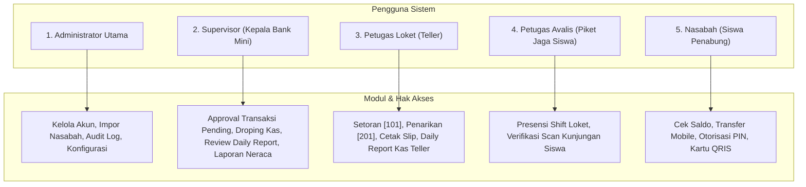
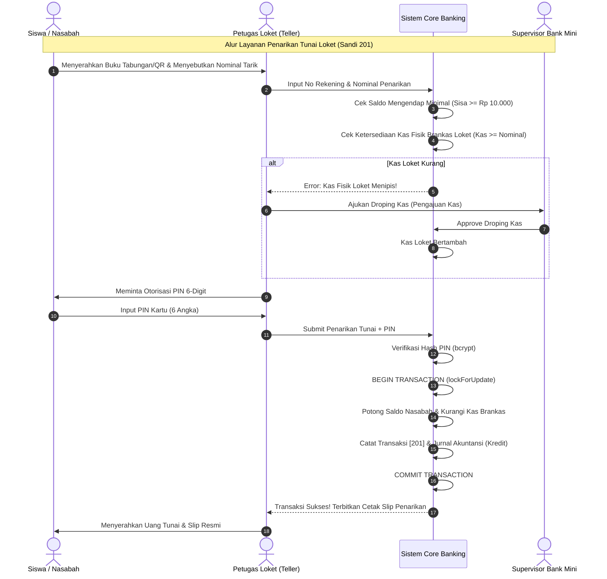
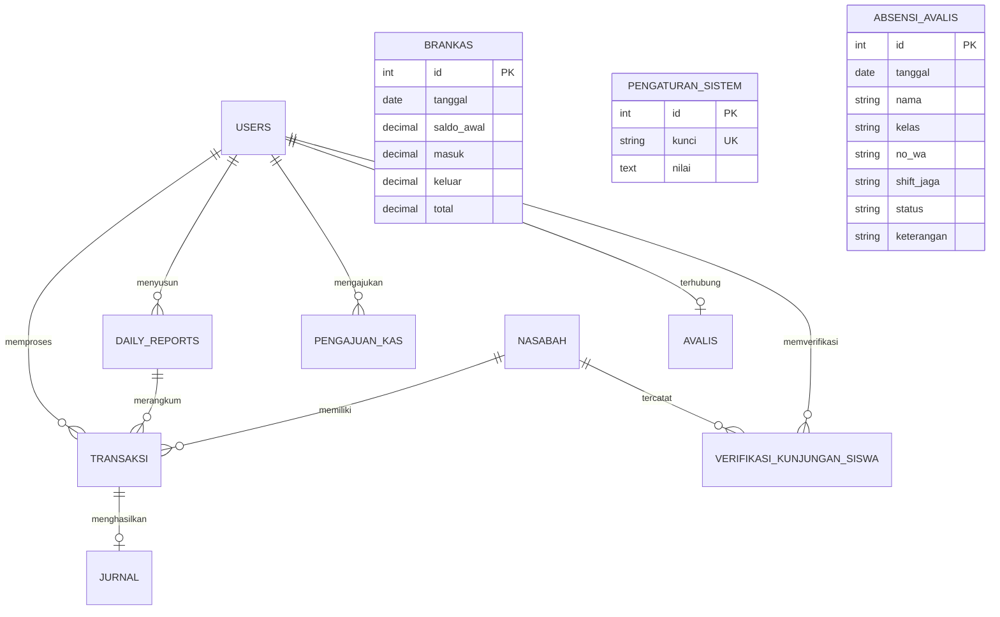

# Product Requirement Document (PRD)
# Sistem Informasi Bank Mini Sekolah Enterprise
### *Core Micro-Banking, Accounting Ledger, Teller POS & Mobile Student Banking System*

---

## 1. Dokumen Kontrol & Identitas Proyek

| Atribut | Informasi |
|---|---|
| **Nama Produk** | Sistem Bank Mini Sekolah (School Mini-Bank System) |
| **Kode Proyek** | `BANKMINI-CBS-2026` |
| **Versi Dokumen** | `v2.4.0 (Comprehensive Release)` |
| **Status Dokumen** | **Approved / Production-Ready** |
| **Target Implementasi** | Laboratorium Perbankan Mini SMK (Jurusan Akuntansi & Keuangan Lembaga / Rekayasa Perangkat Lunak) & Standar Uji Kompetensi Keahlian (UKK) |
| **Teknologi Utama** | PHP 8.5.9, Laravel 13, MySQL / MariaDB, Tailwind CSS, Laravel Sanctum, PHP GD Engine |
| **Tanggal Rilis** | 30 Oktober 2026 |

---

## 2. Ringkasan Eksekutif & Latar Belakang

### 2.1 Konteks Proyek
Di era transformasi digital pendidikan vokasi, institusi Sekolah Menengah Kejuruan (SMK) membutuhkan sarana pembelajaran riil yang merefleksikan alur kerja industri perbankan komersial sesungguhnya. **Sistem Bank Mini Sekolah** dikembangkan sebagai aplikasi perbankan mikro terpadu (*Core Banking System*) yang memfasilitasi transaksi tabungan siswa nyata di sekolah sekaligus menjadi simulator operasional perbankan berstandar akuntansi nasional.

Sistem ini menggabungkan dua ekosistem terpadu:
1. **Portal Web Operasional Sekolah (Back-Office & Front-Office Loket)**: Digunakan oleh Administrator Utama, Supervisor (Kepala Bank Mini), Petugas Teller Loket, dan Petugas Avalis (siswa piket jaga).
2. **REST API Terbuka Berbasis Token (Laravel Sanctum)**: Menyediakan saluran koneksi ke aplikasi *Mobile Banking Siswa* dan *Mobile/Tablet POS Loket*.

### 2.2 Masalah yang Diselesaikan (Problem Statement)
1. **Pencatatan Konvensional yang Rentan Human-Error**: Pencatatan tabungan manual menggunakan buku kas fisik sering menimbulkan selisih kas (*discrepancy*), manipulasi saldo, dan hilangnya rekaman historis.
2. **Ketiadaan Prinsip *Maker-Checker* Perbankan**: Sistem konvensional tidak memiliki kontrol berjenjang, sehingga teller dapat melakukan transaksi tanpa otorisasi atau validasi ketersediaan kas.
3. **Risiko Kas Minus (*Negative Cash Till*)**: Ketiadaan sinkronisasi brankas fisik dapat menyebabkan pengeluaran kas melebihi ketersediaan uang di laci teller.
4. **Pembukuan Akuntansi Terpisah**: Banyak aplikasi tabungan sekolah hanya mencatat mutasi nasabah tanpa menghasilkan buku jurnal akuntansi berpasangan (*double-entry bookkeeping*) untuk neraca dan laporan keuangan.
5. **Keterbatasan Akses Siswa**: Siswa tidak dapat memantau saldo tabungan, riwayat transaksi, atau melakukan transfer secara digital di lingkungan sekolah.

### 2.3 Tujuan Utama Produk (Product Goals)
- **Zero Cash Discrepancy**: Menjamin sinkronisasi 100% antara saldo fisik uang di brankas/loket dengan mutasi digital di sistem.
- **Standar Akuntansi Perbankan**: Otomatisasi jurnal umum debit/kredit setiap kali transaksi setoran, penarikan, atau pemotongan admin terjadi.
- **Keamanan Finansial Berlapis**: Penerapan otorisasi PIN kartu 6-digit, batas saldo minimal mengendap (Rp 10.000), pencegahan kas minus, dan sanitasi berkas profil anti-malware.
- **Kesiapan Uji Kompetensi Keahlian (UKK)**: Memenuhi seluruh indikator kelulusan UKK Akuntansi (penjurnalan, rekonsiliasi kas, neraca, pelaporan) dan RPL (arsitektur web, database relasional, API).

---

## 3. Analisis Pengguna & Matriks Hak Akses (RBAC)



### 3.1 Profil Pengguna (User Personas)

#### 1. Administrator Utama (`role: admin`)
- **Tanggung Jawab**: Pengawas infrastruktur sistem, penanggung jawab tata kelola akun pegawai (Teller, Supervisor), pemelihara basis data nasabah, dan pelaksana konfigurasi global.
- **Aktivitas Harian**:
  - Menambah, mengedit, atau menonaktifkan akun pegawai sistem.
  - Impor data siswa penabung secara massal melalui berkas CSV.
  - Mengubah konfigurasi batas saldo mengendap minimal dan jam operasional.
  - Memantau rekam jejak audit (*audit trail log*) dan ekspor log ke CSV.
  - Menyetujui atau menolak tiket *reset password* pegawai yang lupa kata sandi.

#### 2. Supervisor / Kepala Bank Mini (`role: supervisor`)
- **Tanggung Jawab**: Pejabat otorisasi (*Checker & Approver*) tingkat tinggi yang memantau integritas kas besar (*vault*), keabsahan laporan teller, dan kepatuhan akuntansi.
- **Aktivitas Harian**:
  - Memeriksa dan memberikan pengesahan (*approval*) atas transaksi loket harian.
  - Menyetujui atau menolak permohonan penambahan modal kas loket (*Pengajuan Kas Droping*) dari teller.
  - Memvalidasi dan menandatangani *Daily Report* harian dari masing-masing teller loket.
  - Menginspeksi laporan jurnal akuntansi, saldo simpanan per produk, dan laporan laba/rugi tahunan.

#### 3. Petugas Loket Teller (`role: teller`)
- **Tanggung Jawab**: Pelaksana transaksi operasional di loket (*Maker*), melayani setoran tunai, penarikan tunai, dan rekonsiliasi kas loket harian.
- **Aktivitas Harian**:
  - Menginput saldo awal operasional kas teller.
  - Melayani setoran tunai siswa (Kode Sandi 101) dan menerbitkan slip setoran resmi.
  - Melayani penarikan tunai siswa (Kode Sandi 201) dengan verifikasi PIN 6-digit dan proteksi saldo mengendap.
  - Mengajukan permohonan kas tambahan (*droping kas*) ke Supervisor jika uang fisik di loket menipis.
  - Menyusun *Daily Report* (Laporan Kas Harian) pada akhir jam layanan loket untuk diserahkan ke Supervisor.

#### 4. Petugas Avalis Loket (Siswa Bertugas)
- **Tanggung Jawab**: Siswa jurusan Akuntansi yang ditugaskan piket shift loket bank mini untuk melatih kemampuan pelayanan perbankan nyata.
- **Aktivitas Harian**:
  - Melakukan presensi kehadiran kerja loket (Shift Pagi: 07.30 - 11.30 WIB atau Shift Siang: 11.30 - 15.30 WIB).
  - Melakukan verifikasi fisik kunjungan siswa ke loket melalui pemindaian QR Code / NIS.
  - Menampilkan foto profil resmi berstatus aktif di lembar daftar hadir dan papan jadwal penugasan loket.

#### 5. Nasabah / Siswa Penabung (`role: nasabah / siswa`)
- **Tanggung Jawab**: Pemilik rekening tabungan simpanan pelajar.
- **Aktivitas Harian**:
  - Mengakses aplikasi *Mobile Banking* untuk memantau saldo tabungan secara riil.
  - Melakukan transfer dana tabungan ke rekan siswa lain menggunakan otorisasi PIN 6-digit.
  - Menampilkan kartu identitas tabungan digital berbasis QR Code untuk transaksi loket cepat.
  - Mengunduh atau melihat mutasi pembukuan tabungan.

---

## 4. Standar Operasional Prosedur (SOP) & Alur Bisnis



### 4.1 SOP-01: Pembukaan Rekening Nasabah Baru (Siswa)
1. Administrator menerima formulir pendaftaran nasabah siswa baru dari pihak sekolah/wali kelas.
2. Administrator menginput data siswa: NIS unik, Nama Lengkap, Kelas, Jurusan, Nomor WhatsApp, Username, dan Password awal.
3. Sistem secara otomatis men-generate Nomor Rekening unik terstandar (misal format: `[KodeJurusan]-[NomorUrut]` atau angka seri 8 digit).
4. Akun nasabah langsung aktif dengan saldo awal Rp 0, dan PIN keamanan bawaan diatur ke `123456` yang wajib diganti nasabah saat login pertama kali.

### 4.2 SOP-02: Transaksi Setoran Tunai Loket (Sandi 101)
1. Nasabah mendatangi loket teller dengan membawa uang fisik setoran dan buku tabungan / scan QRIS digital.
2. Teller memasukkan nomor rekening dan nominal setoran ke sistem loket.
3. Sistem memvalidasi bahwa rekening berstatus aktif.
4. Sistem membuka transaksi database atomik:
   - Saldo nasabah bertambah sejumlah nominal setoran.
   - Entri transaksi dicatat dengan kode sandi `101`, status `sukses`, dan nama petugas pencatat.
   - Entri jurnal akuntansi dicatat secara otomatis: **Kas Debit** sebesar nominal setoran.
   - Kas brankas fisik hari berjalan ditambah pada kolom `masuk` dan `total`.
5. Teller mencetak slip setoran tunai rangkap 2 (1 untuk nasabah, 1 untuk arsip bank mini).

### 4.3 SOP-03: Transaksi Penarikan Tunai Loket (Sandi 201)
1. Nasabah mengajukan penarikan tunai di loket teller.
2. Teller memasukkan nomor rekening dan jumlah penarikan yang diminta.
3. **Validasi Aturan Saldo Mengendap**: Sistem memastikan sisa saldo setelah ditarik minimal menyisakan saldo mengendap sesuai konfigurasi (default: Rp 10.000). Jika melanggar, penarikan langsung dibatalkan.
4. **Validasi Otorisasi PIN**: Nasabah memasukkan 6-digit PIN keamanan kartu. Sistem memverifikasi kecocokan hash PIN.
5. **Validasi Proteksi Kas Loket**: Sistem memeriksa kas fisik di brankas hari ini. Jika kas fisik tidak mencukupi, penarikan ditolak dengan pesan: *"Uang kas fisik di loket tidak mencukupi! Kas dilarang minus! Harap ajukan droping kas ke Supervisor."*
6. Jika semua syarat terpenuhi, saldo nasabah dipotong, uang tunai diserahkan, kas brankas dikurangi, dan slip penarikan dicetak.

### 4.4 SOP-04: Koreksi Transaksi (Sandi 102 & 202)
1. Digunakan apabila terjadi kesalahan operasional di loket seperti ditemukannya uang palsu/robek setelah setoran diproses, atau salah ketik nominal oleh teller.
2. **Koreksi Setor [102]**: Saldo nasabah didebet kembali sejumlah uang yang dikoreksi, dan kas loket dikurangi dengan menyertakan alasan koreksi resmi.
3. **Koreksi Tarik [202]**: Pembatalan penarikan yang keliru, saldo nasabah dikembalikan (kredit), dan kas loket disesuaikan.
4. Setiap transaksi koreksi meninggalkan jejak audit permanen di database dan tidak menghapus transaksi asli (*non-destructive append-only audit*).

### 4.5 SOP-05: Pengajuan Droping Kas Loket Teller
1. Ketika kas fisik di laci loket teller tersisa sedikit sementara antrean penarikan tunai tinggi, Teller membuat tiket *Pengajuan Kas* ke Supervisor.
2. Teller menginput nominal droping kas yang dibutuhkan dan alasan penambahan dana operasional.
3. Supervisor memeriksa permohonan melalui dashboard, memeriksa ketersediaan dana cadangan di brankas utama, dan menekan tombol *Setujui* atau *Tolak*.
4. Setelah disetujui, uang fisik diserahterimakan dari Supervisor ke Teller, dan kas operasional teller bertambah di sistem.

### 4.6 SOP-06: Penutupan Kas Harian & Laporan Teller (Daily Report)
1. Pada akhir jam pelayanan perbankan (pukul 15.30 WIB), Teller melakukan penutupan loket.
2. Teller menghitung fisik uang tunai di laci (*cash count*) dan mencocokkannya dengan saldo akhir sistem.
3. Teller menginput rincian penutupan kas pada menu *Daily Report* dan mengirimkannya ke sistem.
4. Supervisor memeriksa rekapitulasi, memverifikasi tidak ada selisih kas (*zero variance*), dan memberikan status *Disetujui* (*Verified*).

### 4.7 SOP-07: Penjadwalan Shift & Presensi Petugas Avalis
1. Administrator Utama menyusun jadwal penugasan loket petugas avalis (Shift Pagi: 07.30 - 11.30 WIB dan Shift Siang: 11.30 - 15.30 WIB).
2. Sistem secara otomatis melakukan sinkronisasi (*auto-sync*) data akun teller ke lembar absensi avalis harian.
3. Petugas avalis melakukan presensi kehadiran loket. Foto profil petugas beresolusi tinggi langsung tampil di tabel presensi, memudahkan pengawas mengidentifikasi petugas yang sedang bertugas di loket.

### 4.8 SOP-08: Verifikasi Kunjungan Fisik Siswa ke Loket
1. Siswa yang mendatangi loket pelayanan bank mini memperlihatkan barcode NIS pada kartu pelajar atau kartu QR digital di ponselnya.
2. Petugas Avalis memindai barcode siswa menggunakan scanner atau input cepat.
3. Sistem memverifikasi dan menandai status siswa menjadi `TERVERIFIKASI HADIR` lengkap dengan timestamp detik kedatangan dan nama petugas verifikator.
4. Pihak sekolah dapat mencetak laporan kunjungan siswa per kelas untuk penilaian keaktifan literasi finansial.

---

## 5. Arsitektur Perangkat Lunak & Infrastruktur

### 5.1 Diagram Arsitektur Komponen

```mermaid
graph TB
    subgraph Client Layer
        WebDesktop["Web Browser Client (Admin, SPV, Teller)"]
        MobileApp["Mobile Banking Client (Siswa)"]
        TabletPOS["Mobile / Tablet POS Loket"]
    end

    subgraph Security & Gateway
        Nginx["Reverse Proxy / Web Server"]
        Sanctum["Laravel Sanctum (Token Auth & Guard)"]
        RoleGuard["RoleGuard Middleware (RBAC)"]
        CSRF["CSRF Verification (Web Only, API Exempt)"]
    end

    subgraph Application Core (Laravel 13)
        Controllers["Web & API Controllers"]
        Services["ProfileImageService (Anti-Malware Engine)"]
        Helpers["AvalisSync, SettingHelper, TerbilangHelper"]
        Models["Eloquent ORM Models (Eager Loading)"]
    end

    subgraph Data & Storage
        MySQL[("MySQL 8.0 / MariaDB InnoDB")]
        Storage["Storage Public (/storage/app/public/profil)"]
    end

    WebDesktop --> Nginx
    MobileApp --> Nginx
    TabletPOS --> Nginx

    Nginx --> CSRF
    CSRF --> RoleGuard
    Nginx --> Sanctum
    Sanctum --> Controllers

    RoleGuard --> Controllers
    Controllers --> Services
    Controllers --> Helpers
    Controllers --> Models

    Services --> Storage
    Models --> MySQL
```

### 5.2 Spesifikasi Teknologi (Technology Stack)
- **Bahasa Pemrograman**: PHP 8.5.9 (Zend Engine v4.5.9).
- **Framework Utama**: Laravel 13.x (Clean Architecture, Strict Return Types, Eloquent Casts).
- **Database Engine**: MySQL 8.0 / MariaDB 10.x (InnoDB Transactional Engine, Foreign Key Constraints).
- **Frontend & Styling**: Blade Templating Engine + Tailwind CSS v3.4 + Heroicons.
- **Autentikasi Token API**: Laravel Sanctum v4 (Personal Access Token, Ability Scopes, Token Pruning).
- **Image Processing & Security**: PHP GD Extension (`imagecreatefrompng`, `imagecreatefromjpeg`, canvas resynthesis).
- **Code Linter & Quality**: Laravel Pint (PSR-12 Compliance, 100% Passed).

---

## 6. Arsitektur Basis Data & Kamus Data Lengkap (11 Tabel)

### 6.1 Diagram Relasi Entitas (ERD)



### 6.2 Kamus Data Detail Seluruh Tabel

#### 1. Tabel `users` (Akun Pegawai Bank Mini)
| Kolom | Tipe Data | Nullable | Keterangan & Aturan |
|---|---|---|---|
| `id` | BIGINT UNSIGNED | NO | Primary Key, Auto Increment |
| `username` | VARCHAR(100) | NO | Unique, kredensial login pegawai |
| `nama_petugas` | VARCHAR(150) | NO | Nama resmi petugas |
| `password` | VARCHAR(255) | NO | Hash bcrypt kata sandi |
| `role` | ENUM('admin','supervisor','teller') | NO | Hak akses pengguna |
| `kelas` | VARCHAR(50) | YES | Divisi/Rombel (contoh: Staff Administrasi, XII AKL 1) |
| `no_hp` | VARCHAR(25) | YES | Nomor kontak seluler petugas |
| `email` | VARCHAR(150) | YES | Email resmi pegawai |
| `foto` | VARCHAR(255) | YES | Path berkas profil (`profil/avatar_<hash>.<ext>`) |
| `created_at` / `updated_at` | TIMESTAMP | YES | Waktu pembuatan & modifikasi |

#### 2. Tabel `nasabah` (Data Siswa Penabung)
| Kolom | Tipe Data | Nullable | Keterangan & Aturan |
|---|---|---|---|
| `id` | BIGINT UNSIGNED | NO | Primary Key, Auto Increment |
| `no_rekening` | VARCHAR(50) | NO | Unique, nomor rekening simpanan pelajar |
| `nis` | VARCHAR(50) | NO | Unique, Nomor Induk Siswa |
| `nama_siswa` | VARCHAR(150) | NO | Nama lengkap siswa penabung |
| `kelas` | VARCHAR(50) | NO | Rombongan belajar (contoh: XI RPL 1, XII AKL 2) |
| `jurusan` | VARCHAR(100) | NO | Program keahlian siswa |
| `username` | VARCHAR(100) | YES | Kredensial login mobile nasabah |
| `password` | VARCHAR(255) | YES | Hash bcrypt kata sandi login mobile |
| `pin_keamanan` | VARCHAR(255) | YES | Hash bcrypt 6 digit PIN otorisasi kartu |
| `saldo` | DECIMAL(15,2) | NO | Saldo tabungan aktif (Default: 0.00) |
| `status` | ENUM('aktif','nonaktif') | NO | Status operasional rekening (Default: aktif) |
| `kategori` | ENUM('siswa','guru','alumni') | NO | Kategori nasabah (Default: siswa) |
| `created_at` / `updated_at` | TIMESTAMP | YES | Timestamp standar |

#### 3. Tabel `transaksi` (Buku Mutasi Transaksi Tabungan)
| Kolom | Tipe Data | Nullable | Keterangan & Aturan |
|---|---|---|---|
| `id` | BIGINT UNSIGNED | NO | Primary Key, Auto Increment |
| `nasabah_id` | BIGINT UNSIGNED | NO | FK ke `nasabah.id` |
| `petugas_id` | BIGINT UNSIGNED | YES | FK ke `users.id` (petugas pemproses) |
| `daily_report_id` | BIGINT UNSIGNED | YES | FK ke `daily_reports.id` |
| `jenis_transaksi` | VARCHAR(50) | NO | Jenis: `setor`, `tarik`, `transfer_masuk`, `transfer_keluar`, `koreksi_setor`, `koreksi_tarik`, `admin` |
| `kode_sandi` | VARCHAR(10) | YES | Sandi perbankan: 101 (Setor), 201 (Tarik), 102 (Koreksi Setor), 202 (Koreksi Tarik), 301 (Admin) |
| `jenis_layanan` | VARCHAR(50) | YES | Produk tabungan (Tabungan Siswa, Qurban, Wisata) |
| `nominal` | DECIMAL(15,2) | NO | Besaran nominal uang transaksi |
| `nama_petugas` | VARCHAR(150) | YES | Snapshot nama teller yang bertugas |
| `status` | VARCHAR(50) | NO | Status: `sukses`, `pending`, `dibatalkan` |
| `idempotency_key` | VARCHAR(100) | YES | Pencegahan eksekusi ganda klik tombol |
| `alasan_batal` | TEXT | YES | Catatan resmi alasan koreksi transaksi |
| `created_at` / `updated_at` | TIMESTAMP | YES | Tanggal & jam transaksi |

#### 4. Tabel `brankas` (Posisi Kas Fisik Harian)
| Kolom | Tipe Data | Nullable | Keterangan & Aturan |
|---|---|---|---|
| `id` | BIGINT UNSIGNED | NO | Primary Key |
| `tanggal` | DATE | NO | Unique per tanggal operasional bank |
| `saldo_awal` | DECIMAL(15,2) | NO | Saldo pembukaan kas loket hari ini |
| `masuk` | DECIMAL(15,2) | NO | Akumulasi penerimaan uang tunai loket hari ini |
| `keluar` | DECIMAL(15,2) | NO | Akumulasi pengeluaran uang tunai loket hari ini |
| `total` | DECIMAL(15,2) | NO | Sisa saldo fisik kas akhir hari berjalan (`saldo_awal + masuk - keluar`) |

#### 5. Tabel `jurnal` / `jurnal_akuntansi` (Buku Besar Akuntansi)
| Kolom | Tipe Data | Nullable | Keterangan & Aturan |
|---|---|---|---|
| `id` | BIGINT UNSIGNED | NO | Primary Key |
| `transaksi_id` | BIGINT UNSIGNED | YES | FK ke `transaksi.id` |
| `tanggal` | DATE | NO | Tanggal pencatatan pembukuan |
| `keterangan` | VARCHAR(255) | NO | Uraian transaksi akuntansi berpasangan |
| `debit` | DECIMAL(15,2) | NO | Nilai mutasi debet kas |
| `kredit` | DECIMAL(15,2) | NO | Nilai mutasi kredit kas |

#### 6. Tabel `absensi_avalis` (Presensi Petugas Piket Avalis)
| Kolom | Tipe Data | Nullable | Keterangan & Aturan |
|---|---|---|---|
| `id` | BIGINT UNSIGNED | NO | Primary Key |
| `tanggal` | DATE | NO | Tanggal tugas operasional |
| `nama` | VARCHAR(150) | NO | Nama petugas avalis (terhubung ke `users.nama_petugas`) |
| `kelas` | VARCHAR(50) | NO | Kelas petugas |
| `no_wa` | VARCHAR(25) | NO | Nomor WhatsApp aktif |
| `shift_jaga` | VARCHAR(100) | NO | `Shift Pagi (07.30 - 11.30)` atau `Shift Siang (11.30 - 15.30)` |
| `status` | ENUM('Hadir','Izin','Tidak Masuk') | NO | Status kehadiran loket |
| `keterangan` | VARCHAR(255) | YES | Tugas pos loket / alasan dispensasi |
| `created_by` | VARCHAR(100) | YES | Pihak pencatat presensi |

#### 7. Tabel `avalis` (Master Petugas Loket Avalis)
| Kolom | Tipe Data | Nullable | Keterangan & Aturan |
|---|---|---|---|
| `id` | BIGINT UNSIGNED | NO | Primary Key |
| `nama` | VARCHAR(150) | NO | Nama lengkap petugas avalis |
| `kelas` | VARCHAR(50) | NO | Kelas / jurusan |
| `no_wa` | VARCHAR(25) | NO | Nomor kontak |
| `user_id` | BIGINT UNSIGNED | YES | Relasi ke `users.id` |
| `status` | ENUM('aktif','nonaktif') | NO | Status keanggotaan avalis (Default: aktif) |

#### 8. Tabel `daily_reports` (Laporan Kas Teller Harian)
| Kolom | Tipe Data | Nullable | Keterangan & Aturan |
|---|---|---|---|
| `id` | BIGINT UNSIGNED | NO | Primary Key |
| `user_id` | BIGINT UNSIGNED | NO | FK ke `users.id` (Teller pelapor) |
| `tanggal` | DATE | NO | Tanggal laporan harian |
| `saldo_awal` | DECIMAL(15,2) | NO | Modal kas pembukaan |
| `total_setoran` | DECIMAL(15,2) | NO | Total penerimaan setoran teller hari ini |
| `total_penarikan` | DECIMAL(15,2) | NO | Total pengeluaran penarikan teller hari ini |
| `saldo_akhir` | DECIMAL(15,2) | NO | Saldo fisik kas penutupan |
| `status` | ENUM('draft','submitted','verified','rejected') | NO | Status verifikasi supervisor |
| `catatan` | TEXT | YES | Catatan telaah supervisor |

#### 9. Tabel `pengajuan_kas` (Tiket Droping Kas Loket)
| Kolom | Tipe Data | Nullable | Keterangan & Aturan |
|---|---|---|---|
| `id` | BIGINT UNSIGNED | NO | Primary Key |
| `user_id` | BIGINT UNSIGNED | NO | FK ke `users.id` (Teller pemohon) |
| `nominal` | DECIMAL(15,2) | NO | Jumlah dana kas yang dimohonkan |
| `keterangan` | TEXT | NO | Alasan kebutuhan droping kas |
| `status` | ENUM('pending','disetujui','ditolak') | NO | Status persetujuan Supervisor |
| `disetujui_oleh` | BIGINT UNSIGNED | YES | FK ke `users.id` (Supervisor yang menyetujui) |

#### 10. Tabel `verifikasi_kunjungan_siswa` (Log Kunjungan Loket Fisik)
| Kolom | Tipe Data | Nullable | Keterangan & Aturan |
|---|---|---|---|
| `id` | BIGINT UNSIGNED | NO | Primary Key |
| `nasabah_id` | BIGINT UNSIGNED | NO | FK ke `nasabah.id` (Siswa pengunjung) |
| `user_id` | BIGINT UNSIGNED | YES | FK ke `users.id` (Petugas loket verifikator) |
| `tanggal` | DATE | NO | Tanggal kunjungan |
| `status_kunjungan` | VARCHAR(50) | NO | `TERVERIFIKASI HADIR` atau `TIDAK HADIR` |
| `waktu_verifikasi` | TIMESTAMP | YES | Jam, menit, detik saat barcode dipindai |
| `nama_petugas` | VARCHAR(150) | YES | Snapshot nama petugas verifikator |
| `catatan` | VARCHAR(255) | YES | Keterangan loket |

#### 11. Tabel `pengaturan_sistem` (Konfigurasi Global Dinamis)
| Kolom | Tipe Data | Nullable | Keterangan & Aturan |
|---|---|---|---|
| `id` | BIGINT UNSIGNED | NO | Primary Key |
| `kunci` | VARCHAR(100) | NO | Unique key (misal: `saldo_mengendap_min`, `nama_bank_mini`) |
| `nilai` | TEXT | NO | Nilai konfigurasi |

---

## 7. Spesifikasi Kebutuhan Fungsional (Functional Requirements)

### 7.1 Modul Autentikasi & Akun
- **FR-01 (Multi-Role Login Web)**: Sistem menyediakan portal login terpadu di mana Admin, Supervisor, dan Teller masuk menggunakan username dan kata sandi, kemudian dialihkan secara otomatis ke dashboard masing-masing via middleware `RoleGuard`.
- **FR-02 (API Token Auth Sanctum)**: Sistem menyediakan endpoint API `/api/nasabah/login` dan `/api/petugas/login` yang menerbitkan Bearer Token Sanctum dengan masa berlaku aman.
- **FR-03 (Manajemen Profil & Foto Aman)**: Pengguna dapat memperbarui profil dan mengunggah foto profil dengan restriksi ketat anti-malware (hanya PNG/JPG, scan payload script, dan canvas re-encoding GD).
- **FR-04 (Tiket Pemulihan Sandi)**: Pegawai yang lupa kata sandi dapat mengajukan tiket lupa password dengan email/OTP yang akan ditinjau dan disetujui langsung oleh Administrator.

### 7.2 Modul Master Data Nasabah & Pegawai
- **FR-05 (Manajemen Pegawai)**: Administrator dapat menambah, melihat, mengedit, dan menghapus akun teller dan supervisor.
- **FR-06 (Manajemen Nasabah)**: Administrator dapat mendaftarkan nasabah secara manual atau impor massal melalui file CSV berbasis template resmi.
- **FR-07 (Buku Tabungan Digital & Cetak)**: Sistem menyediakan lembar buku tabungan resmi yang dapat dicetak langsung (*print-ready*) dengan nomor rekening dan mutasi baris.
- **FR-08 (Otorisasi PIN 6-Digit Siswa)**: Setiap nasabah memiliki 6-digit PIN keamanan kartu yang terenkripsi bcrypt untuk otorisasi penarikan dan transfer.

### 7.3 Modul Transaksi Loket Teller
- **FR-09 (Setoran Tunai Loket - 101)**: Teller memproses setoran tunai siswa dengan penambahan saldo instan, jurnal debet otomatis, penambahan kas brankas, dan penerbitan slip setoran.
- **FR-10 (Penarikan Tunai Loket - 201)**: Teller memproses penarikan tunai siswa dengan validasi berlapis: saldo mengendap minimal, otorisasi PIN 6-digit, dan kecukupan kas fisik loket.
- **FR-11 (Proteksi Kas Minus)**: Sistem secara absolut menolak transaksi penarikan tunai jika uang fisik di brankas loket kurang dari jumlah yang diminta.
- **FR-12 (Cetak Slip Transaksi Resmi)**: Sistem menghasilkan halaman cetak slip setoran/tarik berstandar perbankan yang dilengkapi barcode transaksi dan tanda tangan petugas.
- **FR-13 (Pencarian Nasabah Cepat)**: Teller dapat mencari nasabah dalam waktu < 1 detik berdasarkan NIS, Nomor Rekening, atau Nama Siswa.

### 7.4 Modul Brankas & Akuntansi
- **FR-14 (Sinkronisasi Kas Brankas Harian)**: Setiap mutasi uang fisik langsung memperbarui saldo akhir tabel `brankas` hari ini secara atomik.
- **FR-15 (Jurnal Umum Berpasangan)**: Setiap transaksi finansial otomatis mencatat entri buku besar akuntansi debit/kredit seimbang.
- **FR-16 (Daily Closing Report)**: Teller menyusun laporan kas penutupan harian untuk diserahkan dan disahkan oleh Supervisor.
- **FR-17 (Droping Kas Operasional)**: Teller dapat mengajukan permohonan droping kas ke Supervisor saat kas laci loket menipis.
- **FR-18 (Laporan Akuntansi Terpadu)**: Supervisor dapat melihat dan mencetak jurnal akuntansi, saldo simpanan per produk tabungan, dan laporan keuangan tahunan.

### 7.5 Modul Presensi Avalis & Kunjungan Siswa
- **FR-19 (Sinkronisasi Otomatis Petugas Avalis)**: Sistem menyinkronkan data teller ke lembar absensi avalis harian secara otomatis.
- **FR-20 (Tampilan Foto Profil di Tabel Absensi)**: Tabel presensi avalis menampilkan foto profil bulat petugas dengan titik status kehadiran (Hadir/Izin/Alpha), fallback inisial nama, dan pop-up modal pratinjau resolusi penuh saat foto diklik.
- **FR-21 (Jadwal Shift Loket)**: Sistem mengatur jadwal penugasan loket: Shift Pagi (07.30 - 11.30) dan Shift Siang (11.30 - 15.30).
- **FR-22 (Verifikasi Scan Kunjungan Siswa)**: Petugas avalis memvalidasi kunjungan fisik siswa ke loket melalui pemindaian barcode NIS/QRIS rekening.

---

## 8. Spesifikasi Kebutuhan Non-Fungsional (Non-Functional Requirements)

### 8.1 Keamanan Sistem & Pertahanan Siber (Security)
- **NFR-01 (Multi-Layer Image Security)**: Berkas foto profil diperiksa melalui 5 lapis filter:
  1. Whitelist ekstensi dan MIME type `.png`, `.jpg`, `.jpeg`.
  2. Pemeriksaan Magic Bytes via PHP `finfo` buffer inspection.
  3. Validasi struktur header gambar melalui `getimagesize()`.
  4. Pemindaian ekspresi reguler (regex) untuk mendeteksi payload tersembunyi (`<?php`, `<script>`, `eval(`, base64 shell backdoor, polyglot binary).
  5. Rekonstruksi kanvas gambar penuh menggunakan fungsi GD (`imagecreatefrompng` / `imagecreatefromjpeg` + `imagecopyresampled`) untuk membuang seluruh metadata EXIF dan malicious payload sebelum berkas disimpan dengan nama hash acak.
- **NFR-02 (Password & PIN Hashing)**: Seluruh kata sandi pengguna dan PIN 6-digit nasabah wajib di-hash menggunakan algoritma **Bcrypt** satu arah.
- **NFR-03 (Proteksi Injeksi & XSS)**: Seluruh query database wajib menggunakan PDO Prepared Statements melalui Eloquent ORM. Seluruh output teks di Blade wajib di-escape menggunakan sintaks `{{ }}`.
- **NFR-04 (Role-Based Route Guard)**: URL back-office dilindungi oleh middleware `RoleGuard`. Setiap upaya eskalasi hak akses (misal: Teller membuka `/admin/*`) akan dicegat dengan respon HTTP 403 Forbidden.

### 8.2 Integritas Transaksi & Konkurensi (Data Integrity)
- **NFR-05 (ACID Compliance)**: Seluruh operasi finansial yang melibatkan lebih dari satu tabel wajib dibungkus dalam blok `DB::beginTransaction()` dan `DB::commit()` dengan penanganan error `DB::rollBack()`.
- **NFR-06 (Pencegahan Race Condition)**: Pembacaan saldo nasabah dan kas brankas sebelum mutasi wajib menggunakan klausa `lockForUpdate()` untuk mencegah penarikan ganda di detik yang sama (*double spending*).
- **NFR-07 (Idempotency Key)**: Setiap transaksi pengiriman form loket dilengkapi token unik idempotensi untuk mencegah proses ganda akibat tombol submit ditekan berulang kali.

### 8.3 Kinerja & Responsivitas (Performance)
- **NFR-08 (Waktu Respons API)**: Waktu respons endpoint REST API tidak boleh melebihi 200 milidetik pada beban normal operasional sekolah.
- **NFR-09 (Bebas Masalah Query N+1)**: Seluruh pemanggilan relasi data (misal: data transaksi beserta nasabah, data absensi beserta foto user) wajib menggunakan *eager loading* (`with(['user', 'avalis.user'])`).
- **NFR-10 (Optimasi Indeks Basis Data)**: Kolom-kolom kunci pencarian (`nis`, `no_rekening`, `username`, `tanggal`, `shift_jaga`) wajib diberi indeks database.

### 8.4 Aksesibilitas & Tampilan (Usability)
- **NFR-11 (Desain Responsif & Modern)**: Antarmuka dibangun dengan Tailwind CSS yang responsif, adaptif di layar smartphone, tablet loket, maupun monitor desktop.
- **NFR-12 (Cetak Khusus Print-CSS)**: Halaman slip setoran, slip penarikan, buku tabungan, dan lembar absensi dilengkapi CSS media `@media print` sehingga otomatis menyembunyikan navigasi/tombol saat dicetak di kertas printer loket.

---

## 9. Spesifikasi Lengkap REST API (34 Endpoint)

Semua endpoint API didaftarkan pada file `routes/api.php` dan menghasilkan respon berstandar JSON dengan struktur konsisten:

```json
{
  "success": true,
  "message": "Deskripsi pesan status",
  "data": { ... }
}
```

### 9.1 Modul Sistem & Utilitas

#### 1. `GET /api`
- **Fungsi**: Informasi umum sistem, versi aplikasi, dan status modul API.
- **Autentikasi**: Publik (Tanpa Token).
- **Respon Sukses (200 OK)**:
  ```json
  {
    "success": true,
    "app_name": "Bank Mini Sekolah API",
    "version": "2.0.0",
    "laravel_version": "13.x",
    "status": "operational",
    "modules": {
      "nasabah": "/api/nasabah",
      "petugas": "/api/petugas",
      "avalis": "/api/avalis",
      "laporan": "/api/laporan"
    }
  }
  ```

#### 2. `GET /api/health`
- **Fungsi**: Healthcheck status operasional server, konektivitas database MySQL, dan status penyimpanan berkas storage.
- **Autentikasi**: Publik.
- **Respon Sukses (200 OK)**:
  ```json
  {
    "status": "healthy",
    "timestamp": "2026-10-30T13:00:00+07:00",
    "services": {
      "database": { "status": "connected", "latency_ms": 1.45 },
      "storage": { "public_disk_writable": true }
    },
    "environment": "production"
  }
  ```

#### 3. `GET /api/docs`
- **Fungsi**: Katalog dokumentasi teknis seluruh endpoint API secara terstruktur.
- **Autentikasi**: Publik.

---

### 9.2 Modul Nasabah (Mobile Banking Siswa)

#### 4. `POST /api/nasabah/login`
- **Fungsi**: Autentikasi siswa ke aplikasi Mobile Banking dan penerbitan Bearer Token Sanctum.
- **Payload Request**:
  ```json
  {
    "username": "Handa",
    "password": "password123"
  }
  ```
- **Respon Sukses (200 OK)**:
  ```json
  {
    "success": true,
    "message": "Login Berhasil",
    "token": "5|TzDJpyk5ffUKL...",
    "token_type": "Bearer",
    "data": {
      "id_nasabah": 1,
      "username": "Handa",
      "nama_siswa": "Dewi Handayani Nur Halimah",
      "no_rekening": "202601001"
    }
  }
  ```
  *(Catatan Keamanan: `saldo` sengaja tidak ditampilkan pada respon login dan hanya dapat diakses melalui endpoint terotentikasi `/saldo`)*.

#### 5. `POST /api/nasabah/logout`
- **Fungsi**: Logout dan pencabutan (*revocation*) Bearer token saat ini.
- **Header**: `Authorization: Bearer <token>`.
- **Respon Sukses (200 OK)**: `{"success": true, "message": "Logout Berhasil"}`.

#### 6. `GET /api/nasabah/me`
- **Fungsi**: Mengambil profil lengkap nasabah yang sedang login.
- **Header**: `Authorization: Bearer <token>` *(atau query `?no_rekening=...`)*.
- **Respon Sukses (200 OK)**:
  ```json
  {
    "success": true,
    "data": {
      "id_nasabah": 1,
      "nis": "17763",
      "nama_siswa": "Dewi Handayani Nur Halimah",
      "kelas": "XI RPL 1",
      "jurusan": "Rekayasa Perangkat Lunak",
      "no_rekening": "202601001",
      "username": "Handa",
      "saldo": 50000,
      "formatted_saldo": "Rp 50.000",
      "status": "aktif",
      "has_pin": true
    }
  }
  ```

#### 7. `POST /api/nasabah/update-profil`
- **Fungsi**: Memperbarui kontak nomor handphone dan email nasabah siswa.
- **Header**: `Authorization: Bearer <token>`.
- **Payload Request**: `{"email": "dewi@sekolah.sch.id", "no_hp": "081234567890"}`.

#### 8. `GET /api/nasabah/saldo`
- **Fungsi**: Pengecekan saldo rekening tabungan, batas saldo mengendap, dan saldo yang dapat ditarik.
- **Header**: `Authorization: Bearer <token>` *(opsional jika menyertakan `?no_rekening=...`)*.
- **Respon Sukses (200 OK)**:
  ```json
  {
    "success": true,
    "data": {
      "no_rekening": "202601001",
      "nama_siswa": "Dewi Handayani Nur Halimah",
      "saldo": 50000,
      "formatted_saldo": "Rp 50.000",
      "saldo_mengendap": 10000,
      "saldo_tersedia": 40000
    }
  }
  ```

#### 9. `GET /api/nasabah/cek-rekening`
- **Fungsi**: Inquiry nama dan kelas rekening tujuan sebelum nasabah melakukan transfer dana.
- **Query Parameter**: `?no_rekening=202601002`.
- **Respon Sukses (200 OK)**:
  ```json
  {
    "success": true,
    "message": "Rekening ditemukan",
    "data": {
      "no_rekening": "202601002",
      "nama_siswa": "Siti Aminah",
      "kelas": "XI RPL 1",
      "jurusan": "RPL"
    }
  }
  ```

#### 10. `GET /api/nasabah/qris-payload`
- **Fungsi**: Menghasilkan payload data QR Code kartu identitas nasabah untuk dipindai teller loket.
- **Respon Sukses (200 OK)**:
  ```json
  {
    "success": true,
    "data": {
      "no_rekening": "202601001",
      "nama_siswa": "Dewi Handayani Nur Halimah",
      "nis": "17763",
      "qr_string": "BANKMINI:REK:202601001:NIS:17763:NAMA:Dewi Handayani Nur Halimah",
      "qr_image_url": "https://api.qrserver.com/v1/create-qr-code/?size=250x250&data=..."
    }
  }
  ```

#### 11. `POST /api/nasabah/verify-pin`
- **Fungsi**: Validasi otorisasi 6-digit PIN keamanan kartu nasabah.
- **Payload Request**: `{"no_rekening": "202601001", "pin": "240808"}`.

#### 12. `POST /api/nasabah/ganti-password`
- **Fungsi**: Mengubah kata sandi akun login nasabah.
- **Payload Request**: `{"no_rekening": "202601001", "password_lama": "password123", "password_baru": "secret2026"}`.

#### 13. `POST /api/nasabah/ganti-pin`
- **Fungsi**: Mengubah 6 digit PIN otorisasi transaksi.
- **Payload Request**: `{"no_rekening": "202601001", "pin_lama": "240808", "pin_baru": "112233"}`.

#### 14. `POST /api/nasabah/transfer`
- **Fungsi**: Transfer saldo instan antar-rekening siswa di lingkungan sekolah.
- **Payload Request**:
  ```json
  {
    "no_rekening_pengirim": "202601001",
    "no_rekening_tujuan": "202601002",
    "nominal": 15000,
    "pin": "240808",
    "catatan": "Iuran praktikum kejuruan"
  }
  ```
- **Respon Sukses (200 OK)**:
  ```json
  {
    "success": true,
    "message": "Transfer sejumlah Rp 15.000 ke Siti Aminah berhasil!",
    "data": {
      "nominal": 15000,
      "no_rekening_tujuan": "202601002",
      "nama_penerima": "Siti Aminah",
      "sisa_saldo": 35000,
      "waktu": "2026-10-30 13:15:00"
    }
  }
  ```

#### 15. `GET /api/nasabah/riwayat`
- **Fungsi**: Mengambil daftar mutasi transaksi keluar dan masuk pada rekening nasabah.
- **Query Parameter**: `?no_rekening=202601001&jenis=transfer_keluar`.

#### 16. `GET /api/nasabah/ringkasan`
- **Fungsi**: Ringkasan akumulasi pemasukan (setor, transfer masuk) dan pengeluaran (tarik, transfer keluar) bulan berjalan.

---

### 9.3 Modul Petugas Loket Teller (Mobile POS & Staff)

#### 17. `POST /api/petugas/login`
- **Fungsi**: Autentikasi pegawai loket (Teller, Supervisor, Administrator) dan penerbitan token hak akses.
- **Payload Request**: `{"username": "teller1", "password": "teller123"}`.
- **Respon Sukses (200 OK)**:
  ```json
  {
    "success": true,
    "message": "Login Petugas Berhasil",
    "token": "7|nmhmw0xkeIXKg...",
    "token_type": "Bearer",
    "data": {
      "id": 2,
      "username": "teller1",
      "nama_petugas": "Petugas Loket Teller 1",
      "role": "teller",
      "kelas": "XII AKL 1",
      "foto_url": "http://localhost/storage/profil/avatar_VeJPw3ZATuBkeqS3hOX8o0oKRCa4WgMDTqxU5BqD.jpg"
    }
  }
  ```

#### 18. `POST /api/petugas/logout`
- **Fungsi**: Logout petugas dan pencabutan token sesi loket.

#### 19. `GET /api/petugas/me`
- **Fungsi**: Mengambil profil petugas login serta informasi shift tugas hari ini (Shift Pagi / Shift Siang).

#### 20. `GET /api/petugas/nasabah`
- **Fungsi**: Pencarian cepat data nasabah untuk loket teller.
- **Query Parameter**: `?q=Dewi&kelas=XI RPL 1&status=aktif`.

#### 21. `GET /api/petugas/nasabah/{identifier}`
- **Fungsi**: Mengambil data komprehensif nasabah berdasarkan ID, NIS, atau Nomor Rekening beserta 10 mutasi transaksi terakhir.

#### 22. `POST /api/petugas/transaksi/setor`
- **Fungsi**: Eksekusi transaksi setoran tunai loket teller [Kode Sandi 101].
- **Payload Request**:
  ```json
  {
    "no_rekening": "202601001",
    "nominal": 25000,
    "keterangan": "Setoran tabungan mingguan"
  }
  ```
- **Respon Sukses (200 OK)**:
  ```json
  {
    "success": true,
    "message": "Setoran tunai berhasil diproses!",
    "data": {
      "id_transaksi": 24,
      "kode_sandi": "101",
      "no_rekening": "202601001",
      "nama_siswa": "Dewi Handayani Nur Halimah",
      "nominal": 25000,
      "formatted_nominal": "Rp 25.000",
      "saldo_akhir": 75000,
      "formatted_saldo_akhir": "Rp 75.000",
      "petugas": "Petugas Loket Teller 1",
      "slip_url": "http://localhost/teller/slip-setor/24",
      "waktu": "2026-10-30 13:20:00"
    }
  }
  ```

#### 23. `POST /api/petugas/transaksi/tarik`
- **Fungsi**: Eksekusi penarikan tunai loket [Kode Sandi 201] dengan proteksi saldo mengendap, otorisasi PIN kartu nasabah, dan pengecekan fisik uang kas brankas.
- **Payload Request**:
  ```json
  {
    "no_rekening": "202601001",
    "nominal": 10000,
    "pin": "240808",
    "keterangan": "Penarikan buku tabungan"
  }
  ```

#### 24. `GET /api/petugas/transaksi/hari-ini`
- **Fungsi**: Rekapitulasi seluruh transaksi yang diproses loket teller hari ini lengkap dengan total nominal setoran dan penarikan.

#### 25. `GET /api/petugas/kas`
- **Fungsi**: Posisi kas fisik laci loket dan brankas hari ini (`saldo_awal`, `kas_masuk`, `kas_keluar`, `kas_tersedia`).

---

### 9.4 Modul Avalis & Presensi Petugas

#### 26. `GET /api/avalis/absensi`
- **Fungsi**: Rekapitulasi presensi absensi petugas avalis dengan filter tanggal, shift, dan status.
- **Respon Sukses (200 OK)**:
  ```json
  {
    "success": true,
    "summary": {
      "tanggal": "2026-10-30",
      "total_petugas": 4,
      "hadir": 4,
      "izin": 0,
      "tidak_masuk": 0
    },
    "data": [
      {
        "id": 1,
        "nama": "Petugas Loket Teller 1",
        "foto_url": "http://localhost/storage/profil/avatar_VeJPw3ZATuBkeqS3hOX8o0oKRCa4WgMDTqxU5BqD.jpg",
        "kelas": "XII AKL 1",
        "shift_jaga": "Shift Pagi (07.30 - 11.30)",
        "status": "Hadir"
      }
    ]
  }
  ```

#### 27. `GET /api/avalis/jadwal-hari-ini`
- **Fungsi**: Mengambil jadwal penugasan loket hari ini yang terbagi menjadi kelompok Shift Pagi dan Shift Siang.

#### 28. `POST /api/avalis/absensi/check-in`
- **Fungsi**: Pencatatan presensi mandiri petugas avalis loket.
- **Payload Request**: `{"nama": "Petugas Loket Teller 1", "shift_jaga": "Shift Pagi", "status": "Hadir"}`.

#### 29. `GET /api/avalis/kunjungan-siswa`
- **Fungsi**: Monitoring daftar kunjungan fisik siswa ke loket bank mini per tanggal dan kelas.

#### 30. `POST /api/avalis/kunjungan-siswa/verifikasi`
- **Fungsi**: Verifikasi kedatangan fisik siswa ke loket melalui pemindaian barcode NIS atau nomor rekening.
- **Payload Request**: `{"identifier": "17763", "status_kunjungan": "TERVERIFIKASI HADIR"}`.

---

### 9.5 Modul Laporan & Eksekutif Dashboard

#### 31. `GET /api/laporan/ringkasan-harian`
- **Fungsi**: Metrik eksekutif harian: total simpanan seluruh nasabah, sisa kas fisik di brankas, dan frekuensi transaksi loket.
- **Respon Sukses (200 OK)**:
  ```json
  {
    "success": true,
    "tanggal": "2026-10-30",
    "data": {
      "nasabah": {
        "total_nasabah_aktif": 150,
        "total_dana_tabungan": 18500000,
        "formatted_dana_tabungan": "Rp 18.500.000"
      },
      "kas_operasional": {
        "kas_fisik_tersedia": 5400000,
        "formatted_kas_fisik": "Rp 5.400.000",
        "kas_masuk_hari_ini": 1250000,
        "kas_keluar_hari_ini": 350000
      },
      "transaksi_hari_ini": {
        "frekuensi_transaksi": 32,
        "frekuensi_setor": 25,
        "frekuensi_tarik": 7
      }
    }
  }
  ```

#### 32. `GET /api/laporan/saldo-per-kelas`
- **Fungsi**: Agregasi total saldo tabungan dan rata-rata saldo per rombongan belajar / kelas siswa.

#### 33. `GET /api/laporan/mutasi-jurnal`
- **Fungsi**: Mengambil buku besar jurnal akuntansi perbankan mini (Debit / Kredit) dalam rentang tanggal tertentu.
- **Query Parameter**: `?dari_tanggal=2026-10-01&sampai_tanggal=2026-10-30`.

#### 34. `GET /api/nasabah/profil`
- **Fungsi**: Alias rute untuk endpoint `GET /api/nasabah/me`.

---

## 10. Desain Antarmuka & Wireframe Komponen

### 10.1 Standar Visual & Palet Warna Tailwind CSS
- **Slate Palette (Struktur & Latar)**: `bg-slate-50`, `bg-white`, `border-slate-200`, `text-slate-900`, `text-slate-600` (Nuansa resmi monokrom perbankan korporat).
- **Emerald Palette (Penerimaan / Sukses / Hadir)**: `bg-emerald-500`, `text-emerald-700`, `bg-emerald-50` (Setoran tunai, status hadir, saldo bertambah).
- **Amber Palette (Peringatan / Dispensasi)**: `bg-amber-500`, `text-amber-700` (Dispensasi izin petugas, transaksi pending approval).
- **Rose Palette (Pengeluaran / Ditolak / Kas Minus)**: `bg-rose-500`, `text-rose-700` (Penarikan tunai, kas loket minus, status alpha).
- **Indigo & Sky Palette (Shift Jaga)**: `bg-sky-500` (Shift Pagi: 07.30 - 11.30) dan `bg-indigo-500` (Shift Siang: 11.30 - 15.30).

### 10.2 Komponen Avatar Foto Profil Tabel Absensi
Tabel presensi petugas avalis mengimplementasikan komponen visual responsif:
- Foto ditampilkan dalam wadah bulat `w-10 h-10 rounded-full object-cover border border-slate-200/90 shadow-sm`.
- **Indikator Kehadiran Realtime**: Dot kecil di sudut kanan bawah avatar (`bg-emerald-500` untuk Hadir, `bg-amber-500` untuk Izin, `bg-rose-500` untuk Tidak Masuk) dengan ring border putih pemisah.
- **Fallback Inisial Elegan**: Jika petugas belum mengunggah foto profil kustom, avatar inisial dengan latar belakang `bg-slate-800` dan huruf kapital putih bersih ditampilkan.
- **Modal Pratinjau Pop-up**: Mengklik foto profil akan memicu pemanggilan fungsi JavaScript `openFotoPreview(url, nama, kelas)` yang membuka dialog modal terpusat dengan efek latar belakang blur (`backdrop-blur-sm`), menampilkan foto resolusi penuh, nama lengkap, dan kelas.

---

## 11. Skenario Pengujian & Kriteria Keberterimaan (Acceptance Criteria)

Format pengujian menggunakan sintaks standar BDD / Gherkin (*Given-When-Then*):

### Skenario 1: Penarikan Tunai Berhasil Sesuai Saldo Mengendap Minimal
```gherkin
Given Nasabah "Dewi Handayani" memiliki saldo Rp 50.000
And Saldo mengendap minimal sistem diatur Rp 10.000
And Kas fisik di loket teller tersedia Rp 1.500.000
When Teller memproses penarikan tunai sebesar Rp 25.000
And Nasabah menginputkan PIN 6-digit "240808" dengan benar
Then Transaksi berhasil diproses dengan kode sandi 201
And Saldo akhir Dewi Handayani menjadi Rp 25.000
And Kas fisik loket berkurang menjadi Rp 1.475.000
And Sistem menghasilkan cetak slip penarikan resmi
```

### Skenario 2: Penarikan Tunai Ditolak karena Melanggar Saldo Mengendap
```gherkin
Given Nasabah memiliki saldo Rp 50.000
And Saldo mengendap minimal adalah Rp 10.000
When Teller mencoba memproses penarikan sebesar Rp 45.000
Then Sistem membatalkan transaksi seketika
And Muncul notifikasi error: "Penarikan ditolak karena melanggar aturan saldo mengendap minimal Rp 10.000"
And Saldo nasabah tetap Rp 50.000 dan tidak terjadi mutasi kas
```

### Skenario 3: Penarikan Tunai Ditolak karena Kas Fisik Loket Kurang (Proteksi Kas Minus)
```gherkin
Given Kas fisik di brankas loket teller tersisa Rp 100.000
When Teller memproses penarikan tunai nasabah sebesar Rp 200.000
Then Sistem menolak transaksi dan memicu Rollback database
And Sistem menampilkan peringatan: "PENARIKAN DITOLAK: Uang kas fisik di loket tidak mencukupi! Kas dilarang minus!"
And Teller diarahkan membuat tiket Pengajuan Droping Kas ke Supervisor
```

### Skenario 4: Upload Foto Profil Berbahaya Berisi Skrip Shell Polyglot
```gherkin
Given Pengguna mengunggah berkas gambar yang diberi nama "avatar.jpg"
And Di dalam berkas tersisip kode PHP berbahaya: "<?php system($_GET['cmd']); ?>"
When ProfileImageService memproses berkas unggahan
Then Lapisan regex deep-scan mendeteksi adanya payload script
And Sistem menolak berkas dengan pesan error: "Berkas gambar mengandung kode berbahaya yang tidak diizinkan!"
And Berkas tidak tersimpan ke media penyimpanan
```

---

## 12. Panduan Instalasi, Deployment & Pemeliharaan

### 12.1 Prasyarat Sistem
1. Web Server: Apache 2.4+ atau Nginx 1.20+ (Laragon / XAMPP pada Windows).
2. PHP Runtime: PHP >= 8.2 (Terverifikasi penuh pada PHP 8.5.9) dengan ekstensi aktif: `pdo_mysql`, `gd`, `fileinfo`, `mbstring`, `openssl`, `curl`.
3. Database: MySQL 8.0+ atau MariaDB 10.4+.
4. Dependency Manager: Composer 2.x.

### 12.2 Prosedur Instalasi Baru
```bash
# 1. Masuk ke direktori proyek
cd "D:\Project\Project UKK\belajar_laravel_handa\belajar_laravel_handa"

# 2. Instal dependensi vendor PHP
composer install

# 3. Salin konfigurasi environment
cp .env.example .env

# 4. Generate Application Encryption Key
php artisan key:generate

# 5. Jalankan Migrasi Database & Seeder Bawaan
php artisan migrate --seed

# 6. Buat Symbolic Link Direktori Berkas Publik
php artisan storage:link

# 7. Bersihkan & Optimalkan Cache Rute dan View
php artisan optimize:clear
```

### 12.3 Rutinitas Pemeliharaan Operasional
- **Pruning Token Kedaluwarsa**: Jalankan `php artisan sanctum:prune-expired` setiap tengah malam via Task Scheduler / Cron job.
- **Pemeriksaan Standar Kode**: Jalankan `./vendor/bin/pint --test` sebelum merilis pembaruan kode.
- **Backup Basis Data Harian**: Ekspor file `.sql` database `db_bank_mini_sekolah` setiap akhir sesi layanan loket sekolah.

---

### *Disahkan Oleh:*
- **Tim Pengembang Sistem**: Antigravity AI Engineering & Core Banking Team
- **Institusi**: Bank Mini Laboratorium Akuntansi & RPL SMK
