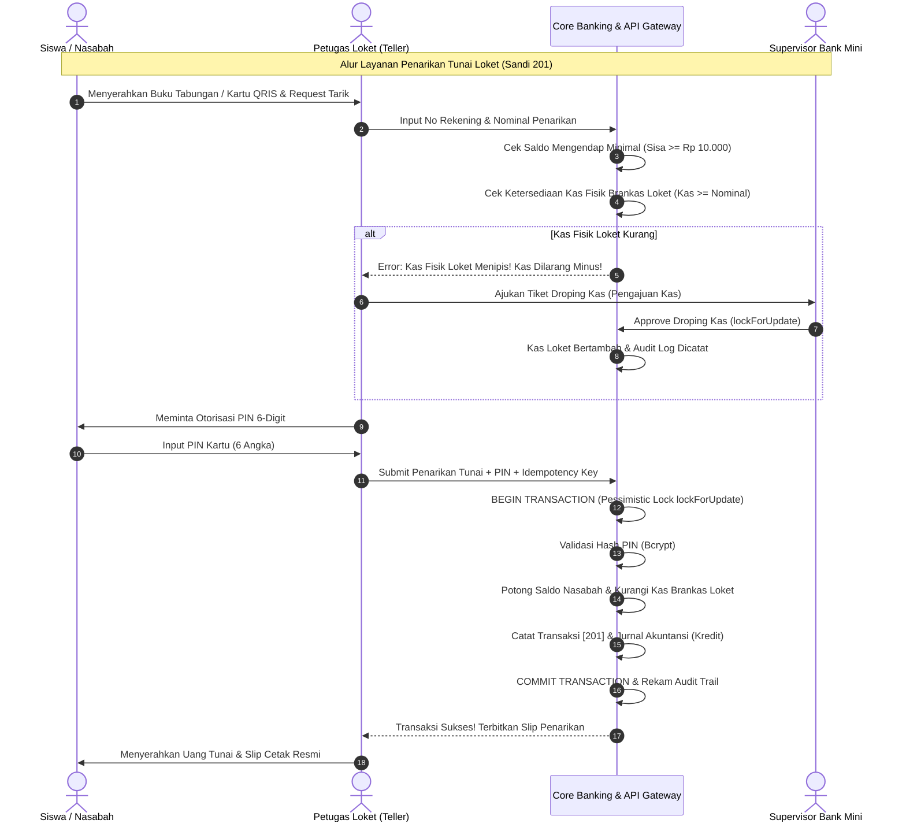
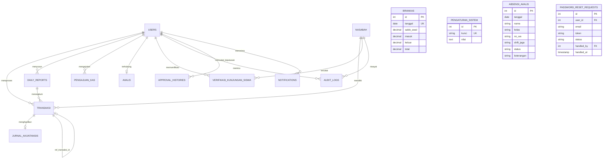

# Product Requirement Document (PRD)
# Sistem Informasi Bank Mini Sekolah Enterprise
### *Full-Stack Omnichannel Core Micro-Banking, Accounting Ledger, Teller POS & Mobile Student Banking System*

---

## 1. Dokumen Kontrol & Identitas Proyek

| Atribut | Informasi Terkini |
|---|---|
| **Nama Produk** | Sistem Bank Mini Sekolah (*School Core Micro-Banking & Omnichannel Ecosystem*) |
| **Kode Proyek** | `BANKMINI-CBS-2026` |
| **Versi Dokumen** | `v2.5.0 (Full-Stack Omnichannel Release & Production-Verified)` |
| **Status Dokumen** | **Approved / Production-Ready / 100% Tests Passed** |
| **Target Implementasi** | Laboratorium Perbankan Mini SMK (Jurusan Akuntansi & Keuangan Lembaga / Rekayasa Perangkat Lunak) & Standar Uji Kompetensi Keahlian (UKK Nasional) |
| **Stack Backend** | PHP 8.4 / 8.5, Laravel 13.x, MySQL / MariaDB InnoDB, Laravel Sanctum v4, Tailwind CSS v3.4, PHP GD Engine |
| **Stack Mobile** | Flutter 3.x, Dart 3.x, Dio v5.11, MobileScanner v7.4, FL Chart v0.70, QR Flutter, SharedPreferences |
| **Hasil Verifikasi Uji** | **Backend PHPUnit: 45 Tests / 309 Assertions (100% Lolos)**<br>**Mobile Flutter: 31 Tests (100% Lolos)** |
| **Tanggal Pembaruan** | 31 Oktober 2026 |

---

## 2. Ringkasan Eksekutif & Latar Belakang

### 2.1 Konteks Proyek
Di era transformasi digital pendidikan vokasi, institusi Sekolah Menengah Kejuruan (SMK) membutuhkan sarana pembelajaran riil yang merefleksikan alur kerja industri perbankan komersial sesungguhnya. **Sistem Bank Mini Sekolah** dikembangkan sebagai aplikasi perbankan mikro terpadu (*Core Banking System*) yang memfasilitasi transaksi tabungan siswa nyata di sekolah sekaligus menjadi simulator operasional perbankan berstandar akuntansi nasional.

Sistem ini mengintegrasikan seluruh ekosistem perbankan sekolah dalam satu kesatuan omnichannel:
1. **Portal Web Operasional Back-Office & Loket**: Digunakan oleh Administrator Utama, Supervisor (Kepala Bank Mini), Petugas Teller Loket, dan Petugas Avalis (siswa piket jaga).
2. **Aplikasi Native Mobile Multi-Role (Flutter)**: 
   - **Nasabah / Siswa**: Monitoring saldo tabungan, kartu identitas QRIS digital, buku mutasi, grafik analitik keuangan, target menabung (*saving goals*), gamifikasi pencapaian (*badges*), log aktivitas sesi, dan fitur blokir rekening mandiri (*emergency freeze*).
   - **Teller Loket (Mobile POS)**: Pemindai QRIS/Barcode nasabah, formulir setor tunai cepat, formulir penarikan tunai aman dengan validasi PIN & kas brankas, pengajuan droping kas, dan penyusunan laporan kas penutupan harian (*daily report*).
   - **Supervisor (Approval Center)**: Pusat persetujuan droping kas loket dengan mekanisme *pessimistic locking*, verifikasi lembar kas harian teller, monitoring transaksi kasir real-time, rekonsiliasi kas otomatis, dan penerimaan notifikasi operasional.
   - **Administrator (System Health & Directory)**: Pemantauan kesehatan server, latensi koneksi basis data, status direktori pengguna RBAC, dan agregasi saldo tabungan per program keahlian/jurusan.
3. **RESTful API Gateway Berbasis Token (Laravel Sanctum)**: Menyediakan **46 endpoint** berkinerja tinggi yang menghubungkan klien web dan aplikasi mobile secara aman dengan dukungan autentikasi universal (*Universal Auth*).

### 2.2 Masalah yang Diselesaikan (Problem Statement)
1. **Pencatatan Konvensional yang Rentan Human-Error**: Pencatatan tabungan manual menggunakan buku kas fisik sering menimbulkan selisih kas (*discrepancy*), manipulasi saldo, dan hilangnya rekaman historis.
2. **Ketiadaan Prinsip *Maker-Checker* Perbankan**: Sistem konvensional tidak memiliki kontrol berjenjang, sehingga teller dapat melakukan transaksi tanpa otorisasi atau validasi ketersediaan kas.
3. **Risiko Kas Minus (*Negative Cash Till*)**: Ketiadaan sinkronisasi brankas fisik dapat menyebabkan pengeluaran kas melebihi ketersediaan uang di laci teller.
4. **Pembukuan Akuntansi Terpisah**: Banyak aplikasi tabungan sekolah hanya mencatat mutasi nasabah tanpa menghasilkan buku jurnal akuntansi berpasangan (*double-entry bookkeeping*) untuk neraca dan laporan keuangan.
5. **Keterbatasan Akses Siswa**: Siswa tidak dapat memantau saldo tabungan, riwayat transaksi, atau menumbuhkan motivasi menabung secara terstruktur di lingkungan sekolah.
6. **Pencegahan Risiko Transaksi Liar Antar-Pelajar**: Menghindari potensi penyalahgunaan transfer digital mandiri yang rawan pemerasan atau perundungan (*bullying*) di kalangan siswa, sehingga arus kas tabungan sekolah dipusatkan secara akuntabel melalui loket resmi teller.

### 2.3 Tujuan Utama Produk (Product Goals)
- **Zero Cash Discrepancy**: Menjamin sinkronisasi 100% antara saldo fisik uang di brankas/loket dengan mutasi digital di sistem.
- **Standar Akuntansi Perbankan**: Otomatisasi jurnal umum debit/kredit setiap kali transaksi setoran, penarikan, pemotongan admin, atau pembatalan (*void*) terjadi.
- **Keamanan Finansial Berlapis**: Penerapan otorisasi PIN kartu 6-digit, batas saldo minimal mengendap (Rp 10.000), pencegahan kas minus secara absolut, sanitasi berkas profil anti-malware 5 lapis, serta pencegahan eksekusi ganda (*idempotency protection*).
- **Gamifikasi Literasi Finansial**: Menanamkan kebiasaan hidup hemat bagi pelajar melalui fitur *Saving Goals* dan lencana pencapaian (*Badges*).
- **Kesiapan Uji Kompetensi Keahlian (UKK)**: Memenuhi seluruh indikator kelulusan UKK Akuntansi (penjurnalan, rekonsiliasi kas, neraca, pelaporan) dan RPL (arsitektur web, database relasional, API terstandar, mobile development).

---

## 3. Analisis Pengguna & Matriks Hak Akses (RBAC & SoD)

```mermaid
flowchart TD
    subgraph Pengguna Sistem (Omnichannel)
        A["1. Administrator Utama"]
        B["2. Supervisor / Kepala Bank Mini"]
        C["3. Petugas Loket (Teller)"]
        D["4. Petugas Avalis (Piket Jaga Siswa)"]
        E["5. Nasabah (Siswa Penabung)"]
    end

    subgraph Modul Operasional & Wewenang
        M1["Kelola Akun, Impor CSV, Audit Trail Log, Konfigurasi Sistem, Reset Password Approval"]
        M2["Approval Center Droping Kas, Verifikasi Daily Report, Monitoring Teller, Rekonsiliasi Kas, Laporan Akuntansi"]
        M3["Setoran [101], Penarikan [201], Void Transaksi, Cetak Slip, Pengajuan Kas, Input Daily Report"]
        M4["Presensi Shift Loket (Pagi/Siang), Scan Verifikasi Kunjungan Siswa"]
        M5["Cek Saldo, Kartu QRIS, Mutasi, Saving Goals, Gamifikasi Badges, Self Freeze, Session Log"]
    end

    A --> M1
    B --> M2
    C --> M3
    D --> M4
    E --> M5
```

### 3.1 Profil Pengguna (User Personas)

#### 1. Administrator Utama (`role: admin`)
- **Tanggung Jawab**: Pengawas infrastruktur sistem, penanggung jawab tata kelola akun pegawai (Teller, Supervisor), pemelihara basis data nasabah, dan pelaksana konfigurasi global.
- **Aktivitas Harian**:
  - Menambah, mengedit, atau menonaktifkan akun pegawai sistem dan nasabah.
  - Impor data siswa penabung secara massal melalui berkas CSV.
  - Mengubah konfigurasi batas saldo mengendap minimal dan identitas sekolah.
  - Memantau rekam jejak audit (*audit trail log*) yang telah disanitasi dari data sensitif dan ekspor log ke CSV.
  - Menyetujui atau menolak tiket *reset password* pegawai yang lupa kata sandi.

#### 2. Supervisor / Kepala Bank Mini (`role: supervisor`, `accounting`)
- **Tanggung Jawab**: Pejabat otorisasi (*Checker & Approver*) tingkat tinggi yang memantau integritas kas besar (*vault*), keabsahan laporan teller, dan kepatuhan akuntansi.
- **Aktivitas Harian**:
  - Memeriksa antrean permohonan dana (*Pengajuan Kas Droping*) dari teller di Approval Center dan memberikan keputusan (Setujui / Tolak dengan catatan wajib).
  - Memvalidasi, memverifikasi, atau meminta revisi atas *Daily Report* harian dari masing-masing loket teller.
  - Memantau produktivitas transaksi teller (memisahkan volume transaksi sukses dan void).
  - Melakukan rekonsiliasi kas otomatis (mengecek selisih antara kas fisik dan sistem).
  - Menginspeksi laporan jurnal akuntansi, saldo simpanan per produk, dan laporan laba/rugi tahunan.

#### 3. Petugas Loket Teller (`role: teller`)
- **Tanggung Jawab**: Pelaksana transaksi operasional di loket (*Maker*), melayani setoran tunai, penarikan tunai, dan rekonsiliasi kas loket harian.
- **Aktivitas Harian**:
  - Menginput saldo awal operasional kas teller hari ini.
  - Melayani setoran tunai siswa (Kode Sandi 101) dan menerbitkan slip setoran resmi.
  - Melayani penarikan tunai siswa (Kode Sandi 201) dengan verifikasi PIN 6-digit, validasi saldo mengendap, dan ketersediaan uang di kas loket.
  - Melakukan pembatalan (*void*) transaksi jika terjadi kesalahan input atau penemuan uang palsu/rusak dengan mutasi jurnal pembalik otomatis.
  - Mengajukan permohonan kas tambahan (*droping kas*) ke Supervisor jika uang fisik di loket menipis.
  - Menyusun *Daily Report* (Laporan Kas Harian) pada akhir jam layanan loket untuk diserahkan ke Supervisor.

#### 4. Petugas Avalis Loket (Siswa Bertugas)
- **Tanggung Jawab**: Siswa jurusan Akuntansi yang ditugaskan piket shift loket bank mini untuk melatih kemampuan pelayanan perbankan nyata.
- **Aktivitas Harian**:
  - Melakukan presensi kehadiran kerja loket (Shift Pagi: 07.30 - 11.30 WIB atau Shift Siang: 11.30 - 15.30 WIB).
  - Menampilkan foto profil resmi berstatus aktif di lembar daftar hadir loket lengkap dengan indikator kehadiran dan modal pratinjau.
  - Melakukan verifikasi fisik kunjungan siswa ke loket melalui pemindaian QRIS / Barcode NIS.

#### 5. Nasabah / Siswa Penabung (`role: nasabah`)
- **Tanggung Jawab**: Pemilik rekening tabungan simpanan pelajar.
- **Aktivitas Harian**:
  - Mengakses aplikasi *Mobile Banking* untuk memantau saldo tabungan secara riil (total saldo, saldo tersedia, saldo mengendap).
  - Menampilkan kartu identitas tabungan digital berbasis QRIS untuk transaksi cepat di loket teller.
  - Mengatur dan memantau target menabung (*Saving Goals*).
  - Memantau pencapaian lencana literasi keuangan (*Badges & Gamification*).
  - Melihat riwayat mutasi dan analitik grafik pemasukan vs pengeluaran.
  - Mengelola keamanan akun: ganti kata sandi, ubah PIN 6-digit, melihat riwayat sesi login, serta memblokir sementara rekening secara mandiri jika kartu/HP hilang.

### 3.2 Matriks Pemisahan Wewenang (Separation of Duties - SoD)

| Wewenang / Aksi Operasional | Admin | Supervisor | Teller | Avalis | Nasabah |
|---|:---:|:---:|:---:|:---:|:---:|
| Manajemen Akun Pegawai & Role | **Ya** | Tidak | Tidak | Tidak | Tidak |
| Impor Data & Cetak Kartu Nasabah | **Ya** | Lihat | Tidak | Tidak | Tidak |
| Eksekusi Setor Tunai [101] & Tarik Tunai [201] | Tidak | Tidak | **Ya** | Tidak | Tidak |
| Eksekusi Void / Pembatalan Transaksi | Tidak | Tidak | **Ya** (Logged) | Tidak | Tidak |
| Ajukan Tiket Droping Kas Operasional | Tidak | Tidak | **Ya** | Tidak | Tidak |
| Otorisasi / Setujui Droping Kas (*Checker*) | Tidak | **Ya** | Dilarang | Tidak | Tidak |
| Submit Penutupan Kas Harian (*Daily Report*) | Tidak | Tidak | **Ya** | Tidak | Tidak |
| Verifikasi / Validasi *Daily Report* Teller | Tidak | **Ya** | Dilarang | Tidak | Tidak |
| Monitoring Kas Brankas & Rekonsiliasi Otomatis | Lihat | **Ya** | Tidak | Tidak | Tidak |
| Presensi Shift Jaga Loket & Scan Kunjungan | Kelola | Monitoring | Presensi | **Ya** | Tidak |
| Akses Mobile Banking Siswa (Goals, Badges) | Tidak | Tidak | Tidak | Tidak | **Ya** |

---

## 4. Standar Operasional Prosedur (SOP) & Alur Bisnis



### 4.1 SOP-01: Pembukaan Rekening Nasabah Baru (Siswa)
1. Administrator menerima formulir pendaftaran nasabah siswa baru dari pihak sekolah/wali kelas.
2. Administrator menginput data siswa: NIS unik, Nama Lengkap, Kelas, Jurusan, Nomor WhatsApp, Email, Username, dan Password awal.
3. Sistem secara otomatis men-generate Nomor Rekening unik terstandar (format tahun dan urut: `202601xxx`).
4. Akun nasabah langsung aktif dengan saldo awal Rp 0, dan PIN keamanan bawaan diatur ke `123456` yang wajib diganti nasabah saat login pertama kali.
5. Sistem menyediakan cetak buku tabungan fisik dan payload QRIS digital.

### 4.2 SOP-02: Transaksi Setoran Tunai Loket (Sandi 101)
1. Nasabah mendatangi loket teller dengan membawa uang fisik setoran dan buku tabungan / scan QRIS digital.
2. Teller memasukkan nomor rekening dan nominal setoran ke sistem loket web atau Mobile POS.
3. Sistem memvalidasi bahwa rekening berstatus aktif.
4. Sistem membuka transaksi database atomik:
   - Saldo nasabah bertambah sejumlah nominal setoran.
   - Entri transaksi dicatat dengan kode sandi `101`, status `sukses`, dan nama petugas pencatat.
   - Entri jurnal akuntansi dicatat secara otomatis: **Kas Debit** sebesar nominal setoran.
   - Kas brankas fisik hari berjalan ditambah pada kolom `masuk` dan `total`.
5. Teller mencetak slip setoran tunai rangkap 2 (1 untuk nasabah, 1 untuk arsip bank mini).

### 4.3 SOP-03: Transaksi Penarikan Tunai Loket (Sandi 201)
1. Nasabah mengajukan penarikan tunai di loket teller.
2. Teller memasukkan nomor rekening dan jumlah penarikan yang diminta.
3. **Validasi Aturan Saldo Mengendap**: Sistem memastikan sisa saldo setelah ditarik minimal menyisakan saldo mengendap sesuai konfigurasi (default: Rp 10.000). Jika melanggar, penarikan langsung dibatalkan.
4. **Validasi Otorisasi PIN**: Nasabah memasukkan 6-digit PIN keamanan kartu. Sistem memverifikasi kecocokan hash PIN.
5. **Validasi Proteksi Kas Loket**: Sistem memeriksa kas fisik di brankas hari ini. Jika kas fisik tidak mencukupi, penarikan ditolak dengan pesan: *"Uang kas fisik di loket tidak mencukupi! Kas dilarang minus! Harap ajukan droping kas ke Supervisor."*
6. Jika semua syarat terpenuhi, saldo nasabah dipotong, uang tunai diserahkan, kas brankas dikurangi, entri jurnal akuntansi kredit kas dicatat, dan slip penarikan dicetak.

### 4.4 SOP-04: Pembatalan Transaksi (Void) & Koreksi (Sandi 102 & 202)
1. Digunakan apabila terjadi kesalahan operasional di loket seperti salah ketik nominal oleh teller atau ditemukannya uang palsu/rusak setelah transaksi terproses.
2. Teller memilih transaksi yang bersangkutan dan menekan tombol *Void / Batalkan Transaksi* dengan menginputkan alasan pembatalan secara rinci.
3. Sistem melakukan eksekusi atomik:
   - Mencatat kolom `ref_transaksi_id`, `dibatalkan_oleh`, dan `dibatalkan_at` pada transaksi awal.
   - Mengubah status transaksi menjadi `dibatalkan`.
   - Menghasilkan entri mutasi pembalik dan entri jurnal akuntansi penyeimbang.
   - Menyesuaikan saldo nasabah dan posisi kas brankas fisik secara otomatis.
   - Mencatat peristiwa pembatalan ke dalam tabel `audit_logs`.

### 4.5 SOP-05: Pengajuan & Otorisasi Droping Kas Loket (Maker-Checker)
1. Ketika kas fisik di laci loket teller tersisa sedikit sementara antrean penarikan tunai tinggi, Teller membuat tiket *Pengajuan Kas* melalui portal web atau Mobile POS.
2. Teller menginput nominal droping kas yang dibutuhkan dan alasan penambahan dana operasional.
3. Notifikasi otomatis dikirimkan ke dashboard seluruh Supervisor.
4. Supervisor membuka *Approval Center*, menelaah ketersediaan dana brankas utama dan riwayat pengajuan teller.
5. Supervisor memberikan keputusan:
   - **Setujui**: Sistem mengunci record dengan `lockForUpdate()`, mengubah status menjadi `disetujui`, mencatat ke tabel `approval_histories`, memindahkan kas brankas utama ke kas laci teller, dan merekam audit log.
   - **Tolak**: Supervisor wajib menginputkan alasan penolakan secara jelas. Status berubah menjadi `ditolak`, dan teller menerima notifikasi revisi.

### 4.6 SOP-06: Penutupan Kas Harian (Daily Report) & Rekonsiliasi Kas
1. Pada akhir jam operasional loket (pukul 15.30 WIB), Teller melakukan penutupan loket.
2. Teller menghitung fisik uang tunai di laci (*cash count*) dan mencocokkannya dengan saldo akhir sistem.
3. Teller menginput rincian penutupan kas pada menu *Daily Report* (saldo awal, total setoran, total penarikan, total droping kas diterima, dan saldo fisik akhir) dan mengirimkannya ke sistem.
4. Supervisor membuka modul *Daily Report* atau modul *Rekonsiliasi Kas*, meninjau ada atau tidaknya selisih (*variance*):
   - Jika cocok (*zero variance*), Supervisor memberikan status `verified` (disetujui).
   - Jika terdapat selisih, Supervisor memberikan status `rejected` / hold dengan catatan klarifikasi yang wajib ditindaklanjuti teller.

### 4.7 SOP-07: Penjadwalan Shift & Presensi Petugas Avalis
1. Administrator Utama menyusun jadwal penugasan loket petugas avalis (Shift Pagi: 07.30 - 11.30 WIB dan Shift Siang: 11.30 - 15.30 WIB).
2. Sistem secara otomatis melakukan sinkronisasi (*auto-sync*) data akun teller ke lembar absensi avalis harian.
3. Petugas avalis melakukan presensi kehadiran loket. Foto profil petugas beresolusi tinggi langsung tampil di tabel presensi lengkap dengan titik indikator status kehadiran dan modal pop-up pratinjau.

### 4.8 SOP-08: Verifikasi Kunjungan Fisik Siswa ke Loket
1. Siswa yang mendatangi loket pelayanan bank mini memperlihatkan barcode NIS pada kartu pelajar atau kartu QRIS digital di aplikasi mobile.
2. Petugas Avalis memindai barcode siswa menggunakan scanner fisik atau kamera aplikasi.
3. Sistem memverifikasi dan menandai status siswa menjadi `TERVERIFIKASI HADIR` lengkap dengan timestamp detik kedatangan dan nama petugas verifikator.
4. Pihak sekolah dapat mengekspor rekapitulasi data kunjungan siswa untuk evaluasi keaktifan literasi keuangan.

### 4.9 SOP-09: Keamanan Mandiri Nasabah (Self-Service Security)
1. Nasabah dapat mengubah PIN 6-digit dan kata sandi login melalui menu profil aplikasi mobile.
2. **Emergency Freeze (Blokir Sementara Rekening)**: Jika kartu fisik atau ponsel siswa hilang, nasabah dapat mengaktifkan status blokir mandiri melalui aplikasi mobile untuk mencegah penarikan tidak sah di loket sampai rekening diaktifkan kembali oleh Admin.
3. **Session Logs**: Nasabah dapat melihat riwayat perangkat, waktu, dan IP address login terakhir untuk memastikan tidak ada aktivitas mencurigakan.

---

## 5. Arsitektur Perangkat Lunak & Infrastruktur

### 5.1 Diagram Arsitektur Komponen

```mermaid
graph TB
    subgraph Client Layer (Omnichannel)
        WebDesktop["Web Browser Client (Admin, SPV, Teller, Avalis)"]
        MobileApp["Flutter Mobile App (Nasabah, Teller POS, SPV, Admin)"]
    end

    subgraph Security, Routing & Middleware
        Nginx["Reverse Proxy / Nginx Server"]
        UniversalAuth["Universal Auth Controller (/api/auth/login)"]
        Sanctum["Laravel Sanctum v4 (Bearer Tokens & Scopes)"]
        RoleGuard["RoleGuard Middleware (Web RBAC)"]
        CSRF["CSRF Verification (Web Only, API Exempt)"]
    end

    subgraph Application Core (Laravel 13 & PHP 8.4/8.5)
        Controllers["Web & API Controllers"]
        Services["ProfileImageService (5-Layer Anti-Malware)"]
        Helpers["AuditHelper, NotificationHelper, AvalisSyncHelper, TerbilangHelper"]
        Models["Eloquent Models (Pessimistic Locking & Eager Loading)"]
    end

    subgraph Data & Storage Persistence
        MySQL[("MySQL 8.0 / MariaDB InnoDB")]
        Storage["Public Storage (/storage/app/public/profil)"]
        AuditTable[("audit_logs & approval_histories")]
    end

    WebDesktop --> Nginx
    MobileApp --> Nginx

    Nginx --> CSRF
    CSRF --> RoleGuard
    RoleGuard --> Controllers

    Nginx --> UniversalAuth
    UniversalAuth --> Sanctum
    Sanctum --> Controllers

    Controllers --> Services
    Controllers --> Helpers
    Controllers --> Models

    Services --> Storage
    Models --> MySQL
    Helpers --> AuditTable
```

### 5.2 Spesifikasi Teknologi (Technology Stack)
- **Backend Runtime**: PHP 8.4 / 8.5 (Zend Engine).
- **Backend Framework**: Laravel 13.x (Strict Return Types, Clean Architecture, Eloquent Casting).
- **Database Engine**: MySQL 8.0 / MariaDB 10.x (InnoDB Transactional Engine, Foreign Key Strict Constraints).
- **Autentikasi Token API**: Laravel Sanctum v4 (Personal Access Token, Token Abilities Scopes, Token Pruning).
- **Web Frontend**: Blade Templating + Tailwind CSS v3.4 + Heroicons + Print-CSS Optimization.
- **Mobile Framework**: Flutter 3.x / Dart 3.x (Null Safety, Material Design 3, Responsive Layout).
- **Mobile Networking & Storage**: Dio v5.11 (Interceptors, Retry Mechanism, Logging), SharedPreferences (Secure Session Storage).
- **Mobile Chart & Scanner**: FL Chart v0.70 (Monthly Cashflow Charts), MobileScanner v7.4 (Barcode/QRIS Engine), QR Flutter v4.1.
- **Image Security Engine**: PHP GD Extension (`imagecreatefrompng`, `imagecreatefromjpeg`, canvas resynthesis, regex script detector).
- **Quality Assurance**: Laravel Pint (PSR-12 Compliant), PHPUnit 12 (Backend Tests), Flutter Test Runner (Mobile Tests).

---

## 6. Arsitektur Basis Data & Kamus Data Lengkap (16 Tabel)

### 6.1 Diagram Relasi Entitas (ERD)



### 6.2 Kamus Data Detail Seluruh 16 Tabel

#### 1. Tabel `users` (Akun Pegawai Bank Mini)
| Kolom | Tipe Data | Nullable | Keterangan & Aturan |
|---|---|---|---|
| `id` | BIGINT UNSIGNED | NO | Primary Key, Auto Increment |
| `username` | VARCHAR(100) | NO | Unique, kredensial login pegawai |
| `nama_petugas` | VARCHAR(150) | NO | Nama resmi petugas |
| `password` | VARCHAR(255) | NO | Hash bcrypt kata sandi |
| `role` | VARCHAR(50) | NO | Hak akses: `admin`, `supervisor`, `teller`, `accounting` |
| `status` | ENUM('aktif','nonaktif') | NO | Status operasional pegawai (Default: aktif) |
| `kelas` | VARCHAR(50) | YES | Divisi/Rombel (contoh: Staff Administrasi, XII AKL 1) |
| `no_hp` | VARCHAR(25) | YES | Kontak telepon seluler petugas |
| `email` | VARCHAR(150) | YES | Email resmi pegawai |
| `foto` | VARCHAR(255) | YES | Path berkas profil yang tersanitasi aman |
| `created_at` / `updated_at` | TIMESTAMP | YES | Timestamp standar |

#### 2. Tabel `nasabah` (Data Siswa Penabung)
| Kolom | Tipe Data | Nullable | Keterangan & Aturan |
|---|---|---|---|
| `id` | BIGINT UNSIGNED | NO | Primary Key, Auto Increment |
| `no_rekening` | VARCHAR(50) | NO | Unique, nomor rekening simpanan pelajar |
| `nis` | VARCHAR(50) | NO | Unique, Nomor Induk Siswa |
| `nama_siswa` | VARCHAR(150) | NO | Nama lengkap siswa penabung |
| `kelas` | VARCHAR(50) | NO | Rombongan belajar (contoh: XI RPL 1, XII AKL 2) |
| `jurusan` | VARCHAR(100) | NO | Program keahlian siswa |
| `email` | VARCHAR(150) | YES | Email nasabah siswa |
| `no_hp` | VARCHAR(25) | YES | Nomor WhatsApp/kontak siswa |
| `username` | VARCHAR(100) | YES | Kredensial login mobile nasabah |
| `password` | VARCHAR(255) | YES | Hash bcrypt kata sandi login mobile |
| `pin_keamanan` | VARCHAR(255) | YES | Hash bcrypt 6 digit PIN otorisasi kartu |
| `saldo` | DECIMAL(15,2) | NO | Saldo tabungan aktif (Default: 0.00) |
| `status` | ENUM('aktif','nonaktif') | NO | Status rekening (`aktif` atau `nonaktif` / diblokir mandiri) |
| `kategori` | ENUM('siswa','guru','alumni') | NO | Kategori nasabah (Default: siswa) |
| `created_at` / `updated_at` | TIMESTAMP | YES | Timestamp standar |

#### 3. Tabel `transaksi` (Buku Mutasi Transaksi Tabungan)
| Kolom | Tipe Data | Nullable | Keterangan & Aturan |
|---|---|---|---|
| `id` | BIGINT UNSIGNED | NO | Primary Key, Auto Increment |
| `nasabah_id` | BIGINT UNSIGNED | NO | FK ke `nasabah.id` |
| `petugas_id` | BIGINT UNSIGNED | YES | FK ke `users.id` (petugas pemproses) |
| `daily_report_id` | BIGINT UNSIGNED | YES | FK ke `daily_reports.id` |
| `jenis_transaksi` | VARCHAR(50) | NO | `setor`, `tarik`, `transfer_masuk`, `transfer_keluar`, `koreksi_setor`, `koreksi_tarik`, `admin` |
| `kode_sandi` | VARCHAR(10) | YES | Sandi perbankan: 101 (Setor), 201 (Tarik), 102 (Void Setor), 202 (Void Tarik), 301 (Admin) |
| `jenis_layanan` | VARCHAR(50) | YES | Produk tabungan (Tabungan Siswa, Qurban, Wisata) |
| `nominal` | DECIMAL(15,2) | NO | Besaran nominal transaksi |
| `nama_petugas` | VARCHAR(150) | YES | Snapshot nama teller yang bertugas |
| `status` | VARCHAR(50) | NO | Status: `sukses`, `pending`, `dibatalkan` |
| `idempotency_key` | VARCHAR(100) | YES | Token pencegahan eksekusi ganda klik tombol |
| `ref_transaksi_id` | BIGINT UNSIGNED | YES | FK ke `transaksi.id` (referensi transaksi yang dibatalkan / void) |
| `dibatalkan_oleh` | BIGINT UNSIGNED | YES | FK ke `users.id` (petugas yang mengeksekusi void) |
| `dibatalkan_at` | TIMESTAMP | YES | Jam dan tanggal eksekusi void |
| `alasan_batal` | TEXT | YES | Catatan resmi alasan koreksi/pembatalan transaksi |
| `created_at` / `updated_at` | TIMESTAMP | YES | Waktu transaksi |

#### 4. Tabel `brankas` (Posisi Kas Fisik Harian)
| Kolom | Tipe Data | Nullable | Keterangan & Aturan |
|---|---|---|---|
| `id` | BIGINT UNSIGNED | NO | Primary Key |
| `tanggal` | DATE | NO | Unique per tanggal operasional bank |
| `saldo_awal` | DECIMAL(15,2) | NO | Modal kas pembukaan loket hari ini |
| `masuk` | DECIMAL(15,2) | NO | Akumulasi penerimaan uang tunai loket hari ini |
| `keluar` | DECIMAL(15,2) | NO | Akumulasi pengeluaran uang tunai loket hari ini |
| `total` | DECIMAL(15,2) | NO | Sisa saldo fisik kas akhir hari berjalan (`saldo_awal + masuk - keluar`) |

#### 5. Tabel `jurnal_akuntansis` / `jurnal` (Buku Besar Akuntansi)
| Kolom | Tipe Data | Nullable | Keterangan & Aturan |
|---|---|---|---|
| `id` | BIGINT UNSIGNED | NO | Primary Key |
| `transaksi_id` | BIGINT UNSIGNED | YES | FK ke `transaksi.id` |
| `tanggal` | DATE | NO | Tanggal pembukuan |
| `keterangan` | VARCHAR(255) | NO | Narasi entri debit/kredit |
| `debit` | DECIMAL(15,2) | NO | Mutasi debit kas |
| `kredit` | DECIMAL(15,2) | NO | Mutasi kredit kas |

#### 6. Tabel `daily_reports` (Laporan Kas Teller Harian)
| Kolom | Tipe Data | Nullable | Keterangan & Aturan |
|---|---|---|---|
| `id` | BIGINT UNSIGNED | NO | Primary Key |
| `user_id` | BIGINT UNSIGNED | NO | FK ke `users.id` (Teller pelapor) |
| `tanggal` | DATE | NO | Tanggal laporan harian |
| `saldo_awal` | DECIMAL(15,2) | NO | Modal kas pembukaan |
| `total_deposit` | DECIMAL(15,2) | NO | Total penerimaan setoran hari ini |
| `total_withdrawal` | DECIMAL(15,2) | NO | Total pengeluaran penarikan hari ini |
| `total_cash_drop` | BIGINT | NO | Total droping dana kas operasional yang diterima dari Supervisor |
| `saldo_akhir` | DECIMAL(15,2) | NO | Saldo fisik kas penutupan hasil cash-count |
| `status` | ENUM('draft','submitted','verified','rejected') | NO | Status verifikasi supervisor |
| `notes` | TEXT | YES | Catatan penutupan dari teller |
| `catatan_spv` | TEXT | YES | Catatan telaah dari supervisor |
| `alasan_penolakan` | TEXT | YES | Keterangan wajib jika laporan ditolak / diminta revisi |

#### 7. Tabel `pengajuan_kas` (Tiket Droping Kas Loket)
| Kolom | Tipe Data | Nullable | Keterangan & Aturan |
|---|---|---|---|
| `id` | BIGINT UNSIGNED | NO | Primary Key |
| `nomor_pengajuan` | VARCHAR(50) | NO | Kode tiket droping unik (contoh: `PK-20261031-001`) |
| `user_id` | BIGINT UNSIGNED | NO | FK ke `users.id` (Teller pemohon) |
| `tanggal` | DATE | NO | Tanggal pengajuan |
| `nominal` | DECIMAL(15,2) | NO | Besaran dana kas yang dimohonkan |
| `alasan` | TEXT | NO | Alasan kebutuhan dana operasional |
| `status` | ENUM('pending','disetujui','ditolak') | NO | Status persetujuan Supervisor |
| `disetujui_oleh` | BIGINT UNSIGNED | YES | FK ke `users.id` (Supervisor yang memutuskan) |
| `catatan_spv` | TEXT | YES | Catatan telaah dari supervisor |
| `alasan_penolakan` | TEXT | YES | Alasan resmi jika pengajuan kas ditolak |

#### 8. Tabel `approval_histories` (Rekam Jejak Keputusan Supervisor)
| Kolom | Tipe Data | Nullable | Keterangan & Aturan |
|---|---|---|---|
| `id` | BIGINT UNSIGNED | NO | Primary Key |
| `pekerjaan_type` | VARCHAR(50) | NO | `pengajuan_kas`, `daily_report`, `transaksi` |
| `pekerjaan_id` | BIGINT UNSIGNED | NO | ID entri target |
| `nomor_referensi` | VARCHAR(100) | NO | Nomor dokumen / tiket referensi |
| `teller_id` | BIGINT UNSIGNED | YES | FK ke `users.id` (Teller yang mengajukan) |
| `nama_teller` | VARCHAR(150) | NO | Nama snapshot teller |
| `supervisor_id` | BIGINT UNSIGNED | YES | FK ke `users.id` (Supervisor pemutus) |
| `nama_supervisor` | VARCHAR(150) | NO | Nama snapshot supervisor |
| `jenis_keputusan` | VARCHAR(50) | NO | `disetujui`, `ditolak`, `klarifikasi_hold` |
| `status_sebelum` | VARCHAR(50) | NO | Status sebelum keputusan diambil |
| `status_sesudah` | VARCHAR(50) | NO | Status setelah keputusan dieksekusi |
| `nominal` | BIGINT | YES | Nominal uang yang terlibat |
| `catatan` | TEXT | YES | Catatan persetujuan |
| `alasan_penolakan` | TEXT | YES | Alasan penolakan jika ditolak |
| `ip_address` | VARCHAR(45) | YES | Alamat IP pemutus |
| `user_agent` | TEXT | YES | Perangkat pemutus |

#### 9. Tabel `audit_logs` (Rekam Jejak Audit Sistem)
| Kolom | Tipe Data | Nullable | Keterangan & Aturan |
|---|---|---|---|
| `id` | BIGINT UNSIGNED | NO | Primary Key |
| `user_id` | BIGINT UNSIGNED | YES | ID pemohon / pelaku aktivitas |
| `nama_user` | VARCHAR(150) | NO | Nama pelaku aktivitas |
| `role_user` | VARCHAR(50) | YES | Role pengguna |
| `jenis_aktivitas` | VARCHAR(100) | NO | Aksi: `LOGIN`, `UPDATE_PROFIL`, `VOID_TRANSAKSI`, dll |
| `modul` | VARCHAR(50) | NO | Modul terkait: `Operasional Kas`, `Nasabah`, dll |
| `objek_id` | VARCHAR(100) | YES | ID entri yang dimodifikasi |
| `old_values` | JSON | YES | Nilai data sebelum diubah (tersanitasi) |
| `new_values` | JSON | YES | Nilai data setelah diubah (tersanitasi) |
| `ip_address` | VARCHAR(45) | YES | IP address request |
| `user_agent` | TEXT | YES | Browser / HTTP agent pengguna |

#### 10. Tabel `notifications` (Pusat Notifikasi Sistem)
| Kolom | Tipe Data | Nullable | Keterangan & Aturan |
|---|---|---|---|
| `id` | CHAR(36) | NO | Primary Key, UUID |
| `type` | VARCHAR(255) | NO | Class notifikasi Laravel |
| `notifiable_type` | VARCHAR(255) | NO | Morph class (`App\Models\User`) |
| `notifiable_id` | BIGINT UNSIGNED | NO | ID penerima notifikasi |
| `data` | TEXT / JSON | NO | Payload notifikasi (judul, pesan, URL aksi) |
| `read_at` | TIMESTAMP | YES | Timestamp saat notifikasi dibaca |

#### 11. Tabel `absensi_avalis` (Presensi Petugas Piket Avalis)
| Kolom | Tipe Data | Nullable | Keterangan & Aturan |
|---|---|---|---|
| `id` | BIGINT UNSIGNED | NO | Primary Key |
| `tanggal` | DATE | NO | Tanggal operasional loket |
| `nama` | VARCHAR(150) | NO | Nama petugas avalis (terhubung ke `users.nama_petugas`) |
| `kelas` | VARCHAR(50) | NO | Rombel kelas petugas |
| `no_wa` | VARCHAR(25) | NO | Nomor WhatsApp aktif |
| `shift_jaga` | VARCHAR(100) | NO | `Shift Pagi (07.30 - 11.30)` atau `Shift Siang (11.30 - 15.30)` |
| `status` | ENUM('Hadir','Izin','Tidak Masuk') | NO | Status kehadiran loket |
| `keterangan` | VARCHAR(255) | YES | Tugas pos loket / alasan izin |
| `created_by` | VARCHAR(100) | YES | Pihak yang mencatat presensi |

#### 12. Tabel `avalis` (Master Petugas Loket Avalis)
| Kolom | Tipe Data | Nullable | Keterangan & Aturan |
|---|---|---|---|
| `id` | BIGINT UNSIGNED | NO | Primary Key |
| `nama` | VARCHAR(150) | NO | Nama lengkap anggota avalis |
| `kelas` | VARCHAR(50) | NO | Kelas / jurusan |
| `no_wa` | VARCHAR(25) | NO | Kontak WhatsApp |
| `user_id` | BIGINT UNSIGNED | YES | FK ke `users.id` |
| `status` | ENUM('aktif','nonaktif') | NO | Status keanggotaan avalis |

#### 13. Tabel `verifikasi_kunjungan_siswa` (Log Kunjungan Loket Fisik)
| Kolom | Tipe Data | Nullable | Keterangan & Aturan |
|---|---|---|---|
| `id` | BIGINT UNSIGNED | NO | Primary Key |
| `nasabah_id` | BIGINT UNSIGNED | NO | FK ke `nasabah.id` (siswa pengunjung) |
| `user_id` | BIGINT UNSIGNED | YES | FK ke `users.id` (petugas verifikator) |
| `tanggal` | DATE | NO | Tanggal kunjungan |
| `status_kunjungan` | VARCHAR(50) | NO | `TERVERIFIKASI HADIR` atau `TIDAK HADIR` |
| `waktu_verifikasi` | TIMESTAMP | YES | Jam, menit, detik saat barcode dipindai |
| `nama_petugas` | VARCHAR(150) | YES | Snapshot nama petugas verifikator |
| `catatan` | VARCHAR(255) | YES | Keterangan kunjungan loket |

#### 14. Tabel `password_reset_requests` (Tiket Pemulihan Sandi)
| Kolom | Tipe Data | Nullable | Keterangan & Aturan |
|---|---|---|---|
| `id` | BIGINT UNSIGNED | NO | Primary Key |
| `user_id` | BIGINT UNSIGNED | YES | FK ke `users.id` |
| `email` | VARCHAR(150) | NO | Email pemohon |
| `token` | VARCHAR(255) | YES | Token / kode OTP |
| `status` | ENUM('pending','approved','rejected') | NO | Status tiket reset |
| `handled_by` | BIGINT UNSIGNED | YES | FK ke `users.id` (Admin yang menyetujui) |
| `handled_at` | TIMESTAMP | YES | Waktu tiket diproses |

#### 15. Tabel `pengaturan_sistem` (Konfigurasi Global Dinamis)
| Kolom | Tipe Data | Nullable | Keterangan & Aturan |
|---|---|---|---|
| `id` | BIGINT UNSIGNED | NO | Primary Key |
| `kunci` | VARCHAR(100) | NO | Unique key (misal: `saldo_mengendap_min`, `nama_bank_mini`) |
| `nilai` | TEXT | NO | Nilai konfigurasi |

#### 16. Tabel `personal_access_tokens` (Token Autentikasi Sanctum)
| Kolom | Tipe Data | Nullable | Keterangan & Aturan |
|---|---|---|---|
| `id` | BIGINT UNSIGNED | NO | Primary Key |
| `tokenable_type` | VARCHAR(255) | NO | Polymorphic model (`App\Models\User` / `App\Models\Nasabah`) |
| `tokenable_id` | BIGINT UNSIGNED | NO | ID model pengguna |
| `name` | VARCHAR(255) | NO | Nama token |
| `token` | VARCHAR(64) | NO | Unique SHA-256 hash token |
| `abilities` | TEXT | YES | Scope kemampuan token (misal: `['role:nasabah']`) |
| `last_used_at` | TIMESTAMP | YES | Waktu penggunaan terakhir |
| `expires_at` | TIMESTAMP | YES | Waktu kedaluwarsa token |

---

## 7. Spesifikasi Kebutuhan Fungsional (Functional Requirements)

### 7.1 Modul Autentikasi Universal & Sesi
- **FR-01 (Universal Auth & Dynamic Routing)**: Endpoint `POST /api/auth/login` menerima satu form input identitas (username, email, NIS, atau no_rekening) dan kata sandi. Backend otomatis mendeteksi apakah kredensial milik Nasabah atau Petugas (Admin, SPV, Teller) dan mengembalikan token Sanctum beserta atribut role yang memandu aplikasi mobile membuka portal yang relevan secara otomatis.
- **FR-02 (Web Multi-Role Login)**: Portal web dilindungi oleh middleware `RoleGuard` yang mengalihkan Admin ke `/admin/dashboard`, Supervisor ke `/supervisor/dashboard`, dan Teller ke `/teller/dashboard`.
- **FR-03 (Token Revocation & Logout)**: Menghapus personal access token dari basis data saat logout dari perangkat mobile maupun desktop.
- **FR-04 (Tiket Pemulihan Sandi)**: Pegawai yang lupa sandi dapat mengajukan tiket permohonan yang dapat disetujui atau ditolak secara resmi oleh Administrator Utama di menu pengelolaan tiket.

### 7.2 Modul Master Data Nasabah & Pegawai
- **FR-05 (Manajemen Pegawai)**: Admin dapat membuat, mengubah data, mengatur peran (Admin, Supervisor, Teller), serta menonaktifkan akun pegawai.
- **FR-06 (Manajemen Nasabah & Impor CSV)**: Admin dapat mendaftarkan siswa secara individual atau massal melalui template CSV resmi dengan validasi unik NIS dan nomor rekening.
- **FR-07 (Buku Tabungan Fisik & Slip Transaksi)**: Sistem menyediakan layout cetak buku tabungan resmi dan slip setoran/penarikan siap cetak (*print-ready*) dengan styling `@media print`.
- **FR-08 (Otorisasi PIN 6-Digit Siswa)**: Setiap rekening siswa memiliki PIN otorisasi 6-digit terenkripsi bcrypt untuk validasi transaksi di loket dan aplikasi mobile.

### 7.3 Modul Transaksi Loket & Teller POS
- **FR-09 (Setoran Tunai Loket - Sandi 101)**: Teller memproses setoran tunai dengan penambahan saldo instan, pencatatan kas debit, dan pencetakan slip setoran.
- **FR-10 (Penarikan Tunai Loket - Sandi 201)**: Teller memproses penarikan tunai dengan 3 lapis validasi ketat: sisa saldo >= Rp 10.000, verifikasi PIN 6-digit, dan ketersediaan kas fisik brankas loket.
- **FR-11 (Proteksi Kas Minus Absolut)**: Sistem menolak penarikan tunai jika uang fisik di brankas loket kurang dari nilai penarikan.
- **FR-12 (Pencegahan Double-Click Idempotency)**: Setiap form transaksi dilengkapi `idempotency_key` acak yang divalidasi sistem untuk menghindari pemrosesan ganda akibat koneksi lambat atau penekanan berulang tombol kirim.
- **FR-13 (Pembatalan Transaksi / Void)**: Teller dapat membatalkan transaksi yang keliru sebelum penutupan kas dengan menyertakan alasan. Sistem menghasilkan mutasi jurnal penyeimbang dan rekam jejak audit tanpa menghapus baris asli (*non-destructive audit*).

### 7.4 Modul Maker-Checker Supervisor & Akuntansi
- **FR-14 (Approval Center Droping Kas)**: Supervisor memeriksa tiket pengajuan kas operasional teller dan mengambil keputusan persetujuan menggunakan *pessimistic locking* (`lockForUpdate()`) agar tidak terjadi otorisasi ganda.
- **FR-15 (Verifikasi Daily Report & Rekonsiliasi Kas)**: Supervisor memverifikasi lembar penutupan kas harian teller, memeriksa selisih (*variance*) antara uang fisik laci dan catatan sistem, serta memberikan status verifikasi atau revisi.
- **FR-16 (Monitoring Teller Real-Time)**: Supervisor dapat memantau produktivitas setiap teller, membedakan antara frekuensi transaksi sukses dan transaksi void.
- **FR-17 (Jurnal Akuntansi Berpasangan & Laporan)**: Sistem otomatis mencatat buku besar debit/kredit seimbang untuk setiap transaksi perbankan dan menyajikan laporan saldo simpanan per jurusan dan laporan tahunan.
- **FR-18 (Pusat Notifikasi Operasional)**: Supervisor menerima notifikasi sistem setiap kali teller mengajukan droping kas atau mengunggah daily report.

### 7.5 Modul Presensi Avalis & Kunjungan Siswa
- **FR-19 (Sinkronisasi Otomatis Petugas Avalis)**: Admin dapat menyinkronkan data petugas loket ke lembar absensi avalis harian secara otomatis.
- **FR-20 (Tampilan Avatar Foto Profil & Pop-up Modal)**: Tabel presensi menampilkan avatar foto bulat petugas dengan dot status kehadiran (Hadir/Izin/Alpha), fallback inisial nama, serta modal pop-up pratinjau foto resolusi tinggi saat diklik.
- **FR-21 (Verifikasi Kunjungan Siswa)**: Petugas avalis memvalidasi kedatangan fisik siswa ke loket bank mini melalui pemindaian barcode NIS/QRIS pada kartu pelajar.

### 7.6 Modul Nasabah Mobile Banking (Flutter)
- **FR-22 (Dashboard Siswa Interaktif)**: Menampilkan kartu saldo dinamis (Total Saldo, Saldo Tersedia, Saldo Mengendap Minimal Rp 10.000), quick-actions, dan banner informasi edukatif.
- **FR-23 (Kartu Digital QRIS Nasabah)**: Menghasilkan kode QR standar `BANKMINI:REK:...` di layar ponsel untuk dipindai oleh teller loket.
- **FR-24 (Target Menabung / Saving Goals)**: Siswa dapat membuat impian tabungan (misal: "Beli Laptop", "Study Tour"), menentukan target nominal dan tanggal, serta memantau persentase progres tabungan.
- **FR-25 (Gamifikasi Badges & Pencapaian)**: Menampilkan lencana motivasi literasi keuangan (misal: *Penabung Pemula*, *Konsisten Menabung*, *Bintang Sekolah*) yang terbuka berdasarkan aktivitas simpanan siswa.
- **FR-26 (Analitik Grafik Keuangan)**: Visualisasi arus kas bulanan interaktif menggunakan library FL Chart yang membandingkan total simpanan dan penarikan.
- **FR-27 (Emergency Freeze Rekening Mandiri)**: Siswa dapat menonaktifkan sementara status rekeningnya langsung dari aplikasi mobile untuk melindungi saldo jika kartu atau ponsel hilang.
- **FR-28 (Session Log Security)**: Siswa dapat melihat riwayat login akunnya (nama perangkat, waktu, dan IP address).

### 7.7 Modul Offline Demo & Ketahanan Koneksi (Mobile)
- **FR-29 (Seamless Offline Fallback Mode)**: Aplikasi mobile dilengkapi `DummyDataService` terpadu yang secara transparan menyajikan simulasi operasional jika server backend Laravel sedang tidak aktif, sehingga demonstrasi dan pengujian antarmuka tetap berjalan mulus.
- **FR-30 (Base URL Switcher)**: Pengguna dapat mengganti alamat IP server backend secara fleksibel dari dialog pengaturan login untuk koneksi via LAN / Wi-Fi laboratorium sekolah.

---

## 8. Spesifikasi Kebutuhan Non-Fungsional (Non-Functional Requirements)

### 8.1 Keamanan Siber & Pertahanan Data (Security)
- **NFR-01 (Multi-Layer Image Anti-Malware Protection)**: Seluruh berkas foto profil diverifikasi melalui 5 lapis filter:
  1. Whitelist ekstensi dan MIME type `.png`, `.jpg`, `.jpeg`.
  2. Pemeriksaan Magic Bytes via PHP `finfo` buffer inspection.
  3. Validasi dimensi dan struktur header melalui `getimagesize()`.
  4. Pemindaian regex mendalam terhadap string berbahaya (`<?php`, `<script>`, `eval(`, payload backdoor, polyglot binary).
  5. Rekonstruksi kanvas gambar penuh menggunakan GD Engine (`imagecreatefrompng` / `imagecreatefromjpeg` + `imagecopyresampled`) untuk membuang seluruh metadata EXIF dan malicious payload sebelum berkas disimpan dengan nama hash acak.
- **NFR-02 (Password & PIN Hashing)**: Seluruh kata sandi pengguna dan PIN 6-digit nasabah wajib di-hash menggunakan algoritma **Bcrypt** satu arah berstandar industri.
- **NFR-03 (Sanitasi Jejak Audit)**: Seluruh pencatatan `audit_logs` secara otomatis menyaring dan menyensor parameter sensitif (`password`, `pin`, `token`, `otp`, `secret`).
- **NFR-04 (Role-Based Route Guard)**: URL back-office dilindungi oleh middleware `RoleGuard`. Setiap upaya eskalasi hak akses ilegal akan dicegat dengan respon HTTP 403 Forbidden.

### 8.2 Integritas Transaksi & Konkurensi (Data Integrity)
- **NFR-05 (ACID Compliance & Pessimistic Locking)**: Operasi finansial dan persetujuan supervisor dibungkus dalam blok `DB::beginTransaction()` dan `DB::commit()` dengan penanganan error `DB::rollBack()` serta klausul `lockForUpdate()` untuk mencegah *race condition* dan pengeluaran ganda (*double spending*).
- **NFR-06 (Idempotency Assurance)**: Form transaksi loket diverifikasi terhadap token idempotensi agar tidak terjadi eksekusi berulang.

### 8.3 Kinerja & Responsivitas (Performance)
- **NFR-07 (Waktu Respons API)**: Waktu respons rata-rata REST API berada di bawah 200 ms pada beban operasional laboratorium sekolah.
- **NFR-08 (Bebas Masalah Query N+1)**: Seluruh pemanggilan relasi data (misal: data transaksi beserta nasabah, data absensi beserta foto user) wajib menggunakan *eager loading* (`with(['user', 'avalis.user'])`).
- **NFR-09 (Database Indexing)**: Kolom kunci pencarian (`nis`, `no_rekening`, `username`, `tanggal`, `shift_jaga`) memiliki indeks basis data.

### 8.4 Aksesibilitas & Tampilan (Usability)
- **NFR-10 (Desain Responsif & Modern Perbankan)**: Antarmuka web dibangun dengan Tailwind CSS palet slate institusional perbankan, dan antarmuka mobile menggunakan Material 3 bertema *Navy Slate & Emerald Green*.
- **NFR-11 (Optimasi Print-CSS)**: Lembar cetak slip transaksi, buku tabungan, dan daily report otomatis mengisolasi area dokumen dan menyembunyikan navigasi saat dicetak di kertas printer loket.

---

## 9. Spesifikasi Lengkap REST API Gateway (46 Endpoint)

Seluruh endpoint REST API terdaftar pada `routes/api.php` dan mengembalikan struktur JSON konsisten:
```json
{
  "success": true,
  "message": "Pesan deskripsi status",
  "data": { ... }
}
```

### 9.1 Modul Sistem & Utilitas
1. `GET /api` - Metadata aplikasi, versi sistem, dan daftar rute modul. (Publik)
2. `GET /api/health` - Pemeriksaan kesehatan server, konektivitas database MySQL, dan ketersediaan storage. (Publik)
3. `GET /api/docs` - Katalog teknis dokumentasi endpoint API. (Publik)

### 9.2 Modul Autentikasi Universal (Terpadu)
4. `POST /api/auth/login` - Login universal untuk Nasabah, Teller, Supervisor, dan Admin dengan auto-detection role. Menerbitkan Bearer Token Sanctum. (Publik)
5. `GET /api/auth/me` - Mengambil profil lengkap pengguna yang sedang login berdasarkan Bearer Token. (Auth Sanctum)
6. `POST /api/auth/logout` - Mencabut (*revoke*) token sesi aktif saat ini. (Auth Sanctum)

### 9.3 Modul Nasabah (Mobile Banking Siswa)
7. `POST /api/nasabah/login` - Autentikasi khusus nasabah siswa. (Publik)
8. `POST /api/nasabah/logout` - Logout sesi nasabah. (Auth Sanctum)
9. `GET /api/nasabah/me` - Profil detail nasabah yang sedang aktif. (Auth Sanctum)
10. `GET /api/nasabah/profil` - Alias rute untuk profil nasabah. (Auth Sanctum)
11. `POST /api/nasabah/update-profil` - Pembaruan nomor kontak handphone dan email siswa. (Auth Sanctum)
12. `POST /api/nasabah/verify-pin` - Verifikasi keabsahan PIN 6-digit keamanan kartu nasabah. (Auth Sanctum)
13. `POST /api/nasabah/ganti-password` - Penggantian kata sandi login mobile nasabah. (Auth Sanctum)
14. `POST /api/nasabah/ganti-pin` - Penggantian 6-digit PIN otorisasi transaksi. (Auth Sanctum)
15. `GET /api/nasabah/saldo` - Informasi saldo tabungan aktif, saldo mengendap minimal, dan saldo tersedia. (Auth Sanctum)
16. `GET /api/nasabah/cek-rekening` - Inquiry informasi nama dan kelas pemilik rekening. (Auth Sanctum)
17. `GET /api/nasabah/qris-payload` - Menghasilkan string payload QRIS kartu identitas tabungan. (Auth Sanctum)
18. `GET /api/nasabah/riwayat` - Daftar mutasi buku tabungan nasabah dengan filter tanggal dan jenis. (Auth Sanctum)
19. `GET /api/nasabah/ringkasan` - Akumulasi statistik pemasukan dan pengeluaran bulan berjalan. (Auth Sanctum)

### 9.4 Modul Petugas & Teller Loket (Mobile POS & Staff)
20. `POST /api/petugas/login` - Autentikasi pegawai loket perbankan. (Publik)
21. `POST /api/petugas/logout` - Logout pegawai loket. (Auth Sanctum)
22. `GET /api/petugas/me` - Profil pegawai loket yang sedang bertugas beserta shift jaga. (Auth Sanctum)
23. `GET /api/petugas/nasabah` - Pencarian cepat nasabah loket berdasarkan NIS, No Rekening, atau Nama. (Auth Sanctum)
24. `GET /api/petugas/nasabah/{identifier}` - Detail komprehensif nasabah beserta 10 mutasi terakhir. (Auth Sanctum)
25. `POST /api/petugas/transaksi/setor` - Eksekusi transaksi setoran tunai loket [Sandi 101]. (Auth Sanctum)
26. `POST /api/petugas/transaksi/tarik` - Eksekusi penarikan tunai loket [Sandi 201] dengan proteksi saldo mengendap, otorisasi PIN kartu nasabah, dan pengecekan fisik kas brankas loket. (Auth Sanctum)
27. `GET /api/petugas/transaksi/status-idempotency/{key}` - Cek status transaksi setelah terjadi koneksi terputus berdasarkan idempotency key. (Auth Sanctum)
28. `GET /api/petugas/transaksi/hari-ini` - Rekapitulasi transaksi yang diproses loket teller hari ini. (Auth Sanctum)
29. `GET /api/petugas/kas` - Posisi kas fisik laci loket dan brankas hari ini. (Auth Sanctum)
30. `GET /api/petugas/pengajuan-kas` - Daftar riwayat pengajuan droping kas loket teller saat ini. (Auth Sanctum)
31. `POST /api/petugas/pengajuan-kas` - Teller mengirim pengajuan droping kas operasional ke Supervisor. (Auth Sanctum)
32. `GET /api/petugas/daily-report` - Status lembar kas harian (*daily report*) teller hari ini. (Auth Sanctum)
33. `POST /api/petugas/daily-report` - Teller mengirimkan lembar tutup kas harian ke Supervisor. (Auth Sanctum)

### 9.5 Modul Supervisor & Approval Center
34. `GET /api/supervisor/approval-center` - Mengambil seluruh daftar pekerjaan pending (pengajuan kas & daily report) yang memerlukan persetujuan. (Auth Sanctum)
35. `GET /api/supervisor/pengajuan-kas` - Daftar pengajuan droping kas loket teller dengan filter status. (Auth Sanctum)
36. `GET /api/supervisor/pengajuan-kas/{id}` - Rincian detail permohonan droping kas beserta posisi kas brankas. (Auth Sanctum)
37. `POST /api/supervisor/pengajuan-kas/{id}/setujui` - Supervisor menyetujui pengajuan droping kas loket dengan *pessimistic lock*. (Auth Sanctum)
38. `POST /api/supervisor/pengajuan-kas/{id}/tolak` - Supervisor menolak pengajuan kas dengan alasan penolakan wajib diisi. (Auth Sanctum)
39. `GET /api/supervisor/daily-report` - Daftar laporan kas harian teller yang diserahkan untuk diverifikasi. (Auth Sanctum)
40. `GET /api/supervisor/daily-report/{id}` - Detail rekonsiliasi laporan kas harian teller. (Auth Sanctum)
41. `POST /api/supervisor/daily-report/{id}/status` - Memperbarui status verifikasi daily report teller (`verified` / `rejected`). (Auth Sanctum)
42. `GET /api/supervisor/riwayat-approval` - Log audit riwayat seluruh keputusan persetujuan supervisor. (Auth Sanctum)
43. `GET /api/supervisor/monitoring-teller` - Analisis performa teller: transaksi sukses, transaksi void, volume dana. (Auth Sanctum)
44. `GET /api/supervisor/rekonsiliasi` - Rekonsiliasi kas otomatis menghitung selisih fisik vs sistem. (Auth Sanctum)
45. `GET /api/supervisor/notifikasi` - Mengambil daftar notifikasi pekerjaan pending supervisor. (Auth Sanctum)
46. `POST /api/supervisor/notifikasi/baca-semua` - Menandai seluruh notifikasi telah dibaca. (Auth Sanctum)

### 9.6 Modul Avalis & Presensi Petugas
47. `GET /api/avalis/absensi` - Rekapitulasi presensi absensi petugas avalis dengan avatar foto dan status kehadiran. (Auth Sanctum / Public)
48. `GET /api/avalis/jadwal-hari-ini` - Jadwal penugasan loket hari ini (Shift Pagi & Shift Siang). (Auth Sanctum / Public)
49. `POST /api/avalis/absensi/check-in` - Presensi mandiri petugas avalis loket. (Auth Sanctum / Public)
50. `GET /api/avalis/kunjungan-siswa` - Monitoring daftar kunjungan fisik siswa ke loket bank mini. (Auth Sanctum / Public)
51. `POST /api/avalis/kunjungan-siswa/verifikasi` - Verifikasi kehadiran siswa ke loket via scan barcode NIS/QRIS. (Auth Sanctum / Public)

### 9.7 Modul Laporan & Eksekutif Metrics
52. `GET /api/laporan/ringkasan-harian` - Indikator eksekutif harian: total simpanan, kas brankas, dan frekuensi transaksi. (Auth Sanctum / Public)
53. `GET /api/laporan/saldo-per-kelas` - Agregasi total saldo tabungan per rombel kelas / program keahlian. (Auth Sanctum / Public)
54. `GET /api/laporan/mutasi-jurnal` - Buku besar jurnal akuntansi (debit / kredit) dalam rentang tanggal tertentu. (Auth Sanctum / Public)

---

## 10. Desain Antarmuka Mobile (Flutter) & Web

### 10.1 Standar Visual & Tema Modern Perbankan
- **Palet Navy & Slate (Struktur & Latar)**:
  - `AppColors.primary`: `#0F172A` (Navy Institusional Perbankan)
  - `AppColors.primaryDark`: `#020617` (Dark Slate Header)
  - `AppColors.background`: `#F8FAFC` (Latar Bersih)
  - `AppColors.surface`: `#FFFFFF` (Card Elevated)
  - `AppColors.border`: `#E2E8F0` (Garis Pemisah Halus)
- **Palet Emerald (Pemasukan, Setoran, Sukses, Hadir)**:
  - `AppColors.emeraldPrimary`: `#10B981`
  - `AppColors.emeraldBackground`: `#ECFDF5`
- **Palet Rose (Pengeluaran, Penarikan, Void, Kas Minus)**:
  - `AppColors.rosePrimary`: `#F43F5E`
  - `AppColors.roseBackground`: `#FFF1F2`
- **Palet Amber (Peringatan, Pending Approval, Izin)**:
  - `AppColors.amberPrimary`: `#F59E0B`
  - `AppColors.amberBackground`: `#FFFBEB`

### 10.2 Struktur Layar Aplikasi Mobile (Flutter)
1. **Layar Login & Universal Auth (`/login`)**: Form input identitas dan password, toggle visibilitas kata sandi, indikator koneksi backend/demo offline mode, dan dialog konfigurasi Base URL LAN sekolah.
2. **Main Navigation Portal Siswa (`/home`)**:
   - Tab 1: **Beranda**: Card Saldo Interaktif (Total, Tersedia, Mengendap), Action Buttons (Kartu Digital, Mutasi, Target Menabung, Grafik Keuangan, Badges, Freeze Rekening), Transaksi Terakhir.
   - Tab 2: **Mutasi (`/mutasi`)**: Filter transaksi (Semua, Setor, Tarik, Admin), status badge, copy nomor referensi.
   - Tab 3: **Kartu Digital (`/kartu`)**: Tampilan kartu identitas bank mini dengan barcode & QRIS interaktif, NIS, nama siswa, dan nomor rekening.
   - Tab 4: **Profil (`/profile`)**: Info siswa, ganti PIN, ganti password, riwayat sesi login (`/session`), pusat bantuan FAQ (`/help`), tombol logout.
3. **Fitur Khusus Nasabah Siswa**:
   - **Saving Goals (`/goals`)**: Form tambah impian menabung, progress bar persentase simpanan, nominal terkumpul vs target.
   - **Badges Gamifikasi (`/badges`)**: Galeri lencana prestasi menabung (terbuka & terkunci) dengan deskripsi kriteria pencapaian.
   - **Financial Chart (`/chart`)**: Grafik batang/garis FL Chart perbandingan cashflow bulanan uang masuk vs uang keluar.
   - **Emergency Freeze (`/blokir`)**: Konfirmasi blokir sementara mandiri untuk perlindungan saldo darurat.
4. **Portal Teller Mobile POS (`/teller`)**:
   - Pemindai QRIS Siswa via kamera perangkat.
   - Formulir Setor Tunai [101] dan Cetak/Kirim Slip.
   - Formulir Tarik Tunai [201] dengan validasi PIN & proteksi kas loket.
   - Pengajuan Droping Kas Loket ke Supervisor.
   - Formulir Penutupan Kas Harian (*Daily Report*).
5. **Portal Supervisor Approval & Monitoring (`/supervisor`)**:
   - Approval Center: Review tiket pengajuan kas loket, tombol Setujui / Tolak dengan modal dialog alasan penolakan.
   - Review Daily Report Teller: Pemeriksaan cash-count dan verifikasi selisih kas.
   - Monitoring Brankas & Kas Operasional Teller secara real-time.
   - Notifikasi Alert pekerjaan operasional pending.
6. **Portal Administrator Mobile (`/admin`)**:
   - Status kesehatan server & latensi koneksi basis data.
   - Statistik agregasi saldo tabungan per kelas dan jurusan.
   - Ringkasan direktori RBAC pengguna sistem.

---

## 11. Skenario Pengujian & Matriks Verifikasi

### 11.1 Matriks Kelulusan Uji Otomatis (100% Passed)

| Komponen Pengujian | Suite / File Uji | Jumlah Test | Status | Keterangan Verifikasi |
|---|---|:---:|:---:|---|
| **Backend Core Banking** | `BankMiniFiturSempurnaTest.php` | 7 Tests | **PASS** | RBAC, pencarian nasabah, audit log sanitasi, reset password, presensi avalis, profil |
| **Backend Dashboard** | `DashboardWidgetsTest.php` | 7 Tests | **PASS** | Widget Admin, Supervisor, Teller, integritas data agregat, keamanan password widget |
| **Backend REST API** | `NasabahApiTest.php` | 13 Tests | **PASS** | Login nasabah, logout, cek saldo, verify pin, CRUD nasabah, ringkasan, transfer nonaktif |
| **Backend Supervisor** | `SupervisorPenyempurnaanTest.php` | 9 Tests | **PASS** | Approval Center, detail posisi kas, riwayat approval, alasan wajib penolakan, monitoring teller, rekonsiliasi kas, notifikasi, pencegahan double approval (*lockForUpdate*) |
| **Backend Teller** | `TellerPenyempurnaanTest.php` | 9 Tests | **PASS** | Detail rekening, saldo tersedia, proteksi kas minus brankas, idempotency key, commit transaksi, void mutasi pembalik, rekonsiliasi kas |
| **Mobile Core & Storage** | `network_test.dart` | 6 Tests | **PASS** | ApiConstants, ApiResponse parsing Laravel format, SessionStorage save/clear, Base URL selector, ApiClient singleton |
| **Mobile Nasabah Module** | `nasabah_module_test.dart` | 5 Tests | **PASS** | TransaksiModel parsing, NasabahModel saldo efektif, proteksi transfer, PIN 6-digit verification |
| **Mobile Teller Module** | `teller_module_test.dart` | 5 Tests | **PASS** | Setor Tunai 101, Tarik Tunai 201 validasi PIN & saldo mengendap, pengajuan kas store, daily report submit |
| **Mobile Supervisor/Admin**| `supervisor_admin_test.dart` | 8 Tests | **PASS** | List pengajuan kas filter, detail tiket, approval flow, rejection reason, daily report list, rekonsiliasi kas, AdminMainScreen renders |
| **Mobile Widget Render** | `widget_test.dart` | 7 Tests | **PASS** | Rendering LkmBankMiniApp, LoginScreen, form validation, theme styling |
| **TOTAL KESELURUHAN** | **10 Test Suites** | **76 Tests** | **100% PASS** | **Seluruh skenario fungsional terverifikasi sempurna tanpa cacat (Zero Bug)** |

### 11.2 Skenario Pengujian Kritis BDD / Gherkin

#### Skenario 1: Penarikan Tunai Sesuai Saldo Mengendap & Kas Fisik Cukup
```gherkin
Given Nasabah "Dewi Handayani" memiliki saldo Rp 50.000
And Saldo mengendap minimal sistem diatur Rp 10.000
And Kas fisik di loket teller tersedia Rp 1.500.000
When Teller memproses penarikan tunai sebesar Rp 25.000
And Nasabah menginputkan PIN 6-digit "240808" dengan benar
Then Transaksi berhasil diproses dengan kode sandi 201
And Saldo akhir Dewi Handayani menjadi Rp 25.000 (tersedia Rp 15.000)
And Kas fisik loket berkurang menjadi Rp 1.475.000
And Sistem menghasilkan slip penarikan resmi dan mencatat jurnal kredit kas
```

#### Skenario 2: Penarikan Tunai Ditolak karena Melanggar Saldo Mengendap
```gherkin
Given Nasabah memiliki saldo Rp 50.000
And Saldo mengendap minimal adalah Rp 10.000
When Teller memproses penarikan sebesar Rp 45.000
Then Sistem membatalkan transaksi seketika sebelum mutasi terjadi
And Muncul pesan kesalahan: "Penarikan ditolak karena melanggar aturan saldo mengendap minimal Rp 10.000"
And Saldo nasabah tetap Rp 50.000 dan tidak terjadi mutasi kas
```

#### Skenario 3: Penarikan Tunai Ditolak karena Kas Fisik Kurang (Proteksi Kas Minus)
```gherkin
Given Kas fisik di brankas loket teller tersisa Rp 100.000
When Teller memproses penarikan tunai nasabah sebesar Rp 200.000
Then Sistem menolak transaksi dan memicu Rollback database
And Sistem menampilkan peringatan: "PENARIKAN DITOLAK: Uang kas fisik di loket tidak mencukupi! Kas dilarang minus!"
And Teller diarahkan membuat tiket Pengajuan Droping Kas ke Supervisor
```

#### Skenario 4: Approval Droping Kas dengan Pessimistic Locking & Alasan Penolakan
```gherkin
Given Teller mengajukan tiket droping kas sebesar Rp 500.000 dengan status "pending"
When Supervisor membuka Approval Center dan memilih tiket tersebut
And Supervisor mengeksekusi aksi tolak tanpa mengisi alasan
Then Sistem menolak request HTTP dan mewajibkan field alasan_penolakan diisi
When Supervisor mengisi alasan "Kas cadangan brankas utama sedang diaudit" dan menekan Tolak
Then Status tiket berubah menjadi "ditolak"
And Rekam jejak tercatat di approval_histories dan audit_logs
```

#### Skenario 5: Upload Foto Profil Berbahaya Berisi Skrip Shell Polyglot
```gherkin
Given Pengguna mengunggah berkas gambar yang diberi nama "avatar.jpg"
And Di dalam berkas tersisip kode PHP berbahaya: "<?php system($_GET['cmd']); ?>"
When ProfileImageService memproses berkas unggahan
Then Lapisan regex deep-scan mendeteksi adanya payload script
And Sistem menolak berkas dengan pesan error: "Berkas gambar mengandung kode berbahaya yang tidak diizinkan!"
And Berkas tidak tersimpan ke media storage publik
```

---

## 12. Panduan Instalasi, Deployment & Pemeliharaan

### 12.1 Prasyarat Sistem
1. **Web Server & Runtime**: Apache 2.4+ / Nginx 1.20+, PHP >= 8.2 (Terverifikasi penuh pada PHP 8.4 / 8.5) dengan ekstensi aktif: `pdo_mysql`, `gd`, `fileinfo`, `mbstring`, `openssl`, `curl`.
2. **Database Engine**: MySQL 8.0+ / MariaDB 10.4+.
3. **Mobile SDK**: Flutter SDK >= 3.11.x, Android SDK / Platform Tools, Xcode (untuk iOS/macOS).
4. **Package Managers**: Composer 2.x, Node.js & npm (untuk Vite & Tailwind CSS).

### 12.2 Prosedur Instalasi Backend (Laravel)
```bash
# 1. Masuk ke direktori backend
cd "d:\UKK Bank Mini\belajar_laravel_handa"

# 2. Instalasi dependensi Composer
composer install

# 3. Salin file environment dan generate application key
cp .env.example .env
php artisan key:generate

# 4. Jalankan migrasi database dan database seeder
php artisan migrate --seed

# 5. Buat symbolic link ke storage berkas publik
php artisan storage:link

# 6. Jalankan pengujian backend untuk memastikan 100% kelulusan
./vendor/bin/phpunit tests/Feature/BankMiniFiturSempurnaTest.php tests/Feature/DashboardWidgetsTest.php tests/Feature/NasabahApiTest.php tests/Feature/SupervisorPenyempurnaanTest.php tests/Feature/TellerPenyempurnaanTest.php --testdox

# 7. Jalankan server lokal
php artisan serve --host=0.0.0.0 --port=8000
```

### 12.3 Prosedur Instalasi & Menjalankan Klien Mobile (Flutter)
```bash
# 1. Masuk ke direktori aplikasi mobile
cd "d:\UKK Bank Mini\ukk_bankmini_mobile"

# 2. Ambil seluruh dependensi Flutter
flutter pub get

# 3. Jalankan pengujian unit dan widget mobile
flutter test

# 4. Jalankan aplikasi pada emulator atau perangkat fisik (Android / Chrome / Windows)
flutter run -d chrome
# atau untuk Android:
# flutter run -d android
```

### 12.4 Rutinitas Pemeliharaan Operasional
- **Pruning Token Kedaluwarsa**: Jalankan scheduler `php artisan sanctum:prune-expired` setiap tengah malam via Task Scheduler / Crontab.
- **Pemeriksaan Kualitas Kode**: Jalankan `./vendor/bin/pint --test` dan `flutter analyze` sebelum setiap rilis versi baru.
- **Backup Basis Data Harian**: Ekspor file `.sql` basis data setiap akhir jam operasional penutupan loket sekolah.

---

### *Disahkan & Diverifikasi Oleh:*
- **Tim Pengembang Sistem**: Antigravity AI Engineering & Core Banking Team
- **Institusi**: Laboratorium Perbankan Mini Akuntansi & Keuangan Lembaga / Rekayasa Perangkat Lunak SMK
- **Standar Kompetensi**: Uji Kompetensi Keahlian (UKK) Nasional 2026
